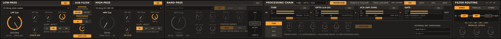

# Dub Filter — Max for Live audio effect (Ableton Live 12)

A performance filter for dub mixing in the Ariwa tradition: big resonant low-pass sweeps, sudden bass removal and instant return, and expressive hands-on control. There are three independent filter engines: low-pass and high-pass, each with six analogue-inspired models, and a band-pass engine with five models and three architectures. New in v1.3 is a reorderable dynamics chain: Tube saturation, an LA-2A-inspired optical compressor and an API 2500-inspired VCA compressor, plus a gate, an external sidechain key and key listen.

*Approximate layout preview rendered from the patch file. Max draws the live.* controls in its own style.*

## What's in the box

| | |
|---|---|
| `DubFilter.amxd` | The device. Drag onto an audio track. |
| `DubFilter.maxpat` | Editable Max patch (identical content). |
| `docs/INSTALL.md` | Installation, plus a fallback procedure if the .amxd will not load. |
| `df_button.js`, `df_routing.js`, `df_arch.js` | v1.5 jsui components. Keep them next to the .amxd, or use Freeze Device in Max to embed them. |
| `docs/UI.md` | v1.5 UI architecture, design system, availability rules, full parameter-to-control mapping. |
| `docs/UI_VALIDATION.md` | v1.5 UI checks (47 offline) and the Max/Live checklist still to run. |
| `docs/ROUTING.md` | v1.4 filter routing: SERIES / PARALLEL / HYBRID, parallel levels, how the sum works. |
| `docs/CHAIN.md` | v1.3 processing chain: modules, reordering, detector sourcing, gain staging, latency, limitations. |
| `docs/BPF.md` | v1.2 band-pass engine: architectures, models, native/derived matrix, sources. |
| `docs/MODELS.md` | The six models, the capability matrix, approximations and limitations, and how to add a model. |
| `docs/PARAMETERS.md` | All 20 parameters, automation names, CHARACTER per model, MIDI-mapping tips. |
| `docs/ARCHITECTURE.md` | Signal flow, filter topologies, smoothing, state handling, CPU strategy. |
| `docs/VALIDATION.md` | Validation report with frequency-response plots, tables, CPU benchmark and a manual test checklist for Live. |
| `source/`, `build.sh` | Generator, transpiler/checker, test harness, device builder. |

## The instrument

- **LOW-PASS** (amber) and **HIGH-PASS** (copper) stages, each with a large CUTOFF knob, RESONANCE, DRIVE, COMP, a model-specific CHARACTER knob, a 12/24/36/48 dB slope selector and ON.
- **Models:** 01 Sherman Filterbank · 02 Korg 35 / MS-20 · 03 Moog-style Ladder · 04 Steiner-Parker · 05 Oberheim SEM · 06 TB-303 Diode (LPF only). Each is built from the published circuit or circuit analysis of its namesake (sources in MODELS.md), and each matches its circuit's transfer function to within 0.05 dB. The HPF menu has no 303, and the ladder's highpass is labelled "ALT pole-mix" in the menu.
- **BAND-PASS** (brass, v1.2): Model (SEM, Steiner-Parker, Korg 35/MS-20, ARP 2600, EMS VCS3), Architecture (SVF / CASCADE / MULTIMODE), CENTRE, BW, Q, RES, DRIVE, COMP, MIX, POST/PRE position. Off by default.
- **PROCESSING CHAIN** (v1.3): three draggable blocks (TUBE, OPTO, VCA) with ON, IN/OUT meters and GR, any of the six orders (WARM DUB / PUNCH & COLOUR / FINAL COLOUR as starting points), a GATE, KEY LISTEN, a KEY FROM external key, and an EDIT page for each module's controls. Everything is off by default.
- **FILTER ROUTING** (v1.4): run the LPF, HPF and BPF in SERIES (default), PARALLEL (summed, with a level per path) or HYBRID (LP/HP in series, BPF in parallel). A live signal-flow readout shows the result.
- **Centre strip:** stage ORDER (LP>HP / HP>LP), 1x/2x OVERSAMPLE, OUTPUT, SOFT CLIP.
- **OPEN zones:** LPF fully clockwise or HPF fully anticlockwise crossfades that stage to the dry signal, so "both open" is transparent.
- Every control is smoothed per sample. Model, slope, order and oversampling changes are click-free during playback.

## Classic moves
- **The drop:** HPF to about 300–600 Hz on the downbeat, back to OPEN on the "one". Map it to a pad (see PARAMETERS.md).
- **The long sweep:** Ladder or Sherman LPF, Resonance 60–80 %, a slow sweep from OPEN to 200 Hz over a few bars.
- **The scream:** Sherman with FEEDBACK at 40–70 %, resonance just under self-oscillation. Ride the cutoff.
- **MS-20 rig:** both stages on K35, Order HP>LP, resonance up on both. Narrow the band and sweep.

## Status
The DSP was validated offline by running the exact gen~ code: 95 of 95 checks pass. They include bit-exact regression of the v1.1 LPF/HPF, v1.2 BPF and v1.3 dynamics engines, exact parallel/hybrid filter sums, all six chain orders and all 30 live reorders, and sidechain and gate behaviour (see VALIDATION.md). The chain UI's drag/move/page logic is verified statically, not yet run in Max. The device file itself has **not yet been opened in Max or Live**. Please run the short manual checklist at the end of VALIDATION.md on first use. v1.5 changed only the interface: the gen~ code is byte-identical to v1.4. Its 47 offline UI checks pass, and its Max/Live checklist is in UI_VALIDATION.md.

The models are inspired by the named instruments. They are not affiliated with, endorsed by, or claimed to be equivalent to products of Sherman, Korg, Moog, Steiner-Parker, Oberheim, Roland, ARP, EMS, Teletronix/Universal Audio or API.
