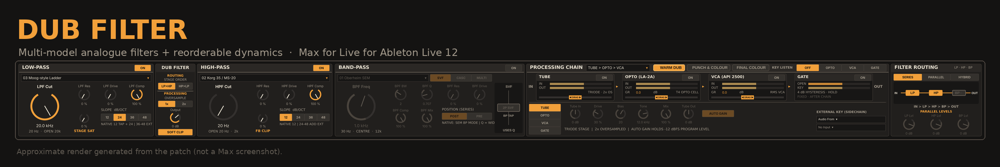
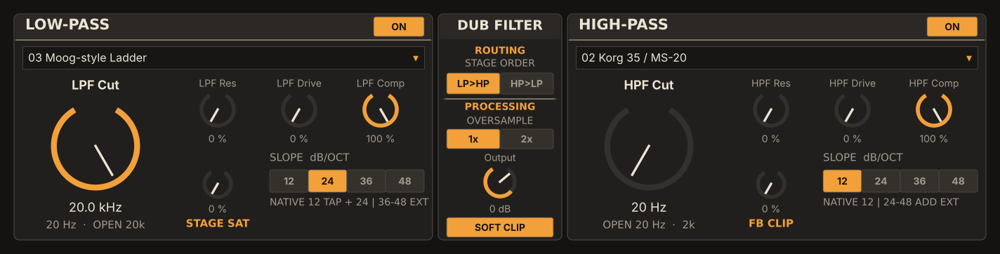
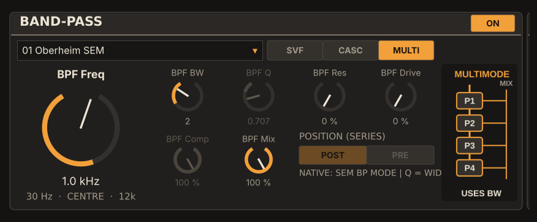
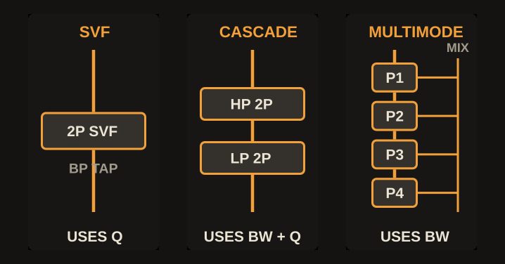
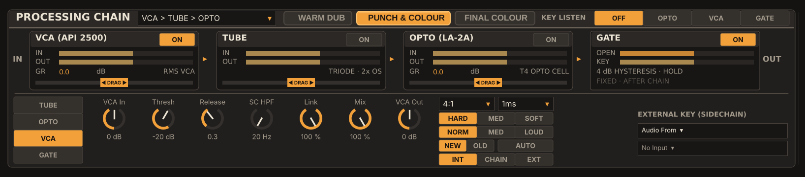
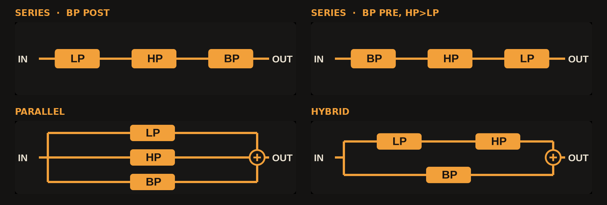
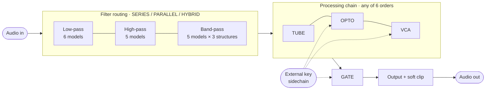

<p align="center">
  
</p>

<h3 align="center">A dub mixing filter in the Ariwa tradition, built from real circuit analysis.</h3>

<p align="center">
  
  
  
  
  
  
</p>

<p align="center">
  <a href="#quick-start">Quick start</a> ·
  <a href="#the-instrument">The instrument</a> ·
  <a href="#signal-flow">Signal flow</a> ·
  <a href="#classic-moves">Classic moves</a> ·
  <a href="#documentation">Docs</a> ·
  <a href="#building-from-source">Build</a> ·
  <a href="#status">Status</a>
</p>

---

The device is made for the big resonant low-pass sweep, the sudden bass drop and instant return, and the screaming feedback ride, all with hands-on control. It has three filter engines with 16 analogue-inspired models between them, which you can route in series, in parallel or both. After them comes a reorderable chain of tube, opto and VCA dynamics, with a gate and an external sidechain.

- **Real models, no substitution.** Each model runs its own engine, built from the published circuit analysis of its namesake. At low levels each one matches its circuit's analogue transfer function to within 0.05 dB.
- **Click-free while playing.** Every control is smoothed per sample. Changes of model, slope, order, routing and chain order crossfade.
- **Transparent when open.** With the LPF fully up and the HPF fully down, the stage crossfades to the dry signal.
- **Sets and automation keep working.** Each release is checked so that Live Sets, presets, automation and MIDI maps from earlier versions load unchanged.

## Quick start

1. Download or clone this repository.
2. Keep **`DubFilter.amxd`** and the three **`df_*.js`** files together in one folder.
3. Drag `DubFilter.amxd` onto an audio track in Ableton Live 12.
4. Sweep **LPF Cut**, and you're dubbing.

If the device won't load, see [docs/INSTALL.md](docs/INSTALL.md). To share the device as a single file, open it in the Max editor and choose **Freeze Device**, which embeds the `.js` files.

## The instrument



### Low-pass & high-pass

The LPF and HPF have the same layout:
- a large cutoff knob
- Resonance, Drive and Compensation
- a **Character** knob whose job changes with the model
- slope: 12 / 24 / 36 / 48 dB per octave
- an ON switch

| # | Model | LPF | HPF | Character knob |
|---|---|:-:|:-:|---|
| 01 | Sherman Filterbank | ✓ | ✓ | Feedback |
| 02 | Korg 35 / MS-20 | ✓ | ✓ | FB Clip |
| 03 | Moog-style ladder | ✓ | ✓ (ALT pole-mix) | Stage Sat |
| 04 | Steiner-Parker | ✓ | ✓ | BP Blend |
| 05 | Oberheim SEM | ✓ | ✓ | Notch Morph |
| 06 | TB-303 diode ladder | ✓ | — | Squelch |

The **centre strip** has two groups:
- **Routing:** the stage order, LP>HP or HP>LP.
- **Processing:** 1x/2x oversampling, output level and the soft clipper.

### Band-pass

 

There are five models: Oberheim SEM, Steiner-Parker, Korg 35 / MS-20, ARP 2600 and EMS VCS3. The ARP and EMS models are labelled *derived*, because those instruments have no native band-pass mode.

Each model can run as one of three structures, and each structure reads different width controls. The panel dims any control the current structure doesn't use, and the glyph beside it shows the structure:

| Structure | How it works | Width controls it reads |
|---|---|---|
| SVF | A 2-pole state-variable filter | Q only |
| CASCADE | A 2-pole high-pass feeding a 2-pole low-pass | Bandwidth and Q |
| MULTIMODE | A 4-pole ladder with its poles mixed | Bandwidth only |

The band-pass also has Mix and a PRE/POST position for series routing.

### Processing chain

 TUBE > OPTO order" width="100%">

**TUBE, OPTO and VCA** can run in any of the six possible orders:
- **TUBE:** triode saturation, 2× oversampled, with auto gain.
- **OPTO:** inspired by the LA-2A, using a model of its T4 optical cell.
- **VCA:** inspired by the API 2500, with Thrust and NEW/OLD detector types.

To change the order, drag a block's grip or pick from the menu. Three buttons give suggested starting orders, and the matching one lights up:

| Button | Order |
|---|---|
| WARM DUB | TUBE → OPTO → VCA |
| PUNCH & COLOUR | VCA → TUBE → OPTO |
| FINAL COLOUR | OPTO → VCA → TUBE |

A **GATE** follows the chain. The opto, the VCA and the gate can each be keyed from their own input, from the chain input, or from an **external sidechain** track. **Key Listen** lets you hear any of the three detectors.

### Filter routing



| Mode | Signal path |
|---|---|
| **SERIES** (default) | The filters are chained. The BPF goes before or after LP/HP. |
| **PARALLEL** | LP, HP and BP all take the input and are summed, each with its own level. |
| **HYBRID** | LP/HP in series, with the BPF added in parallel. |

The diagram is drawn from the same state the engine uses, and it marks bypassed stages.

## Signal flow



## Classic moves

| Move | How |
|---|---|
| **The drop** | HPF to about 300–600 Hz on the downbeat, back to OPEN on the "one". Map it to a pad. |
| **The long sweep** | Ladder or Sherman LPF, Resonance 60–80 %. Sweep slowly from OPEN down to 200 Hz over a few bars. |
| **The scream** | Sherman with Feedback at 40–70 % and resonance just under self-oscillation. Ride the cutoff. |
| **MS-20 rig** | Both stages on K35, order HP>LP, resonance up on both. Narrow the band and sweep. |
| **Dub split** | PARALLEL: the LPF on the bass weight, and the BPF swept through the mids at −6 dB. |
| **Warm bus** | WARM DUB order: tube colour, then the opto gently levelling, then the VCA catching peaks. |

## Documentation

| Topic | Document |
|---|---|
| Installing, and what to do if the device won't load | [INSTALL.md](docs/INSTALL.md) |
| Interface: design system, components, the dimming rules, a map of the parameters | [UI.md](docs/UI.md) |
| LPF/HPF models, capability matrix, sources | [MODELS.md](docs/MODELS.md) |
| v1.6 engine: stability fix, fault containment, 4x–16x oversampling, Reference mode (before/after numbers) | [V1.6_ENGINE.md](docs/V1.6_ENGINE.md) |
| Band-pass engine: structures, native and derived models | [BPF.md](docs/BPF.md) |
| Filter routing and how the parallel sum works | [ROUTING.md](docs/ROUTING.md) |
| Processing chain: modules, reordering, sidechain, latency | [CHAIN.md](docs/CHAIN.md) |
| LPF/HPF parameters, Character per model, MIDI-mapping tips | [PARAMETERS.md](docs/PARAMETERS.md) |
| Engine internals: topologies, smoothing, state, CPU | [ARCHITECTURE.md](docs/ARCHITECTURE.md) |
| DSP validation: plots, tables, CPU benchmark | [VALIDATION.md](docs/VALIDATION.md) |
| UI validation and the in-Live checklist | [UI_VALIDATION.md](docs/UI_VALIDATION.md) |
| Release history | [CHANGELOG.md](CHANGELOG.md) |

## Building from source

The device is generated, not hand-patched. `./build.sh` regenerates everything and stops at the first failure. It needs Python 3 with numpy and matplotlib, a C compiler, Node.js and `rsvg-convert`. In order, it:

1. Generates the GenExpr engine (`source/src/`).
2. Transpiles the engine to C and statically checks it (`source/tools/genexpr2c.py`).
3. Runs the exact shipped gen~ code offline against bit-exact golden renders.
4. Runs the 95 DSP checks.
5. Builds `DubFilter.amxd` and `DubFilter.maxpat`.
6. Checks compatibility with every earlier release.
7. Runs the 47 UI checks.
8. Renders the previews.

```
.
├── DubFilter.amxd / .maxpat   the device
├── df_*.js                    jsui components (keep beside the device)
├── docs/                      documentation, validation plots, renders
└── source/
    ├── src/                   engine generator: filters, BPF, dynamics, routing
    ├── device/                patch builder, design tokens, jsui sources, preview renderer
    ├── tools/                 GenExpr→C transpiler, jsui simulator, filter design
    └── tests/                 golden renders, validation suites, compatibility snapshots
```

## Status

| Area | State |
|---|---|
| DSP engine | 95/95 + 22/22 (v1.6) offline checks pass, running the exact gen~ code. v1.6 changes Sherman, Steiner and the BPF SVF slightly (a stability fix); every other render is bit-exact against v1.1–v1.5. See [V1.6_ENGINE.md](docs/V1.6_ENGINE.md). |
| Compatibility | Every parameter, connection and gen~ Param is intact against all earlier releases. |
| Interface (v1.5, plus the v1.6 ENGINE strip) | 47/47 offline checks pass: structure, wiring, layout, contrast, and the component code run outside Max. |
| **In Max / Live** | **Not yet opened in Max or Live.** v1.6's GenExpr is about 14,000 lines; please report its compile time. Please run the checklists in [VALIDATION.md](docs/VALIDATION.md) and [UI_VALIDATION.md](docs/UI_VALIDATION.md) on first use, and open an issue with what you find. |

The panel images on this page are approximate renders generated from the patch file. They are not Max screenshots.

---

<sub>The models are inspired by the named instruments. They are not affiliated with, endorsed by, or claimed to be equivalent to products of Sherman, Korg, Moog, Steiner-Parker, Oberheim, Roland, ARP, EMS, Teletronix/Universal Audio or API. All trademarks belong to their owners.</sub>
