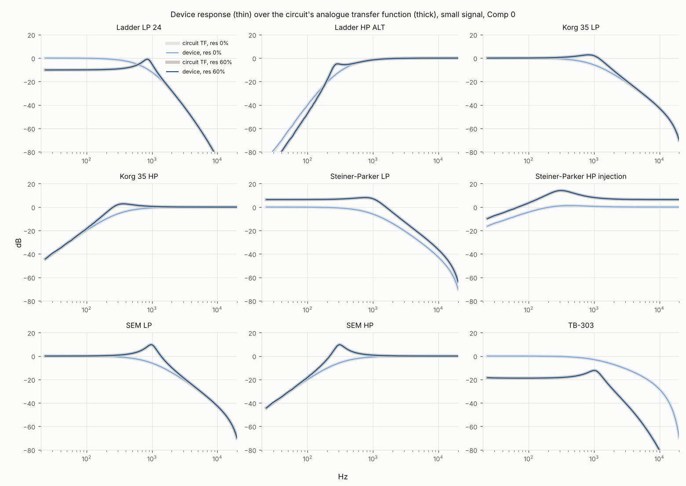
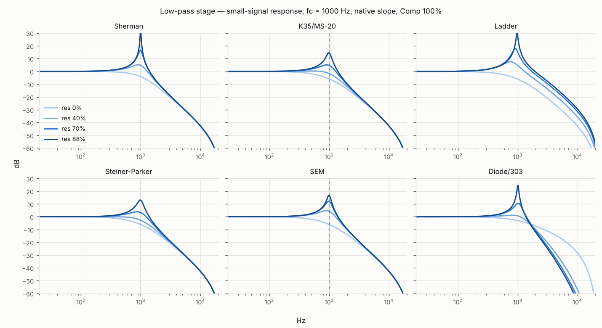
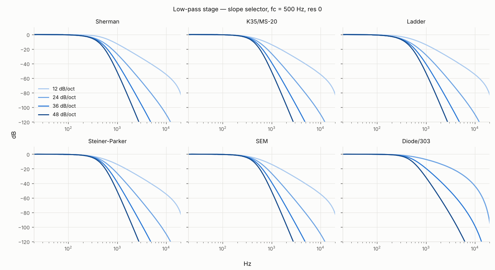
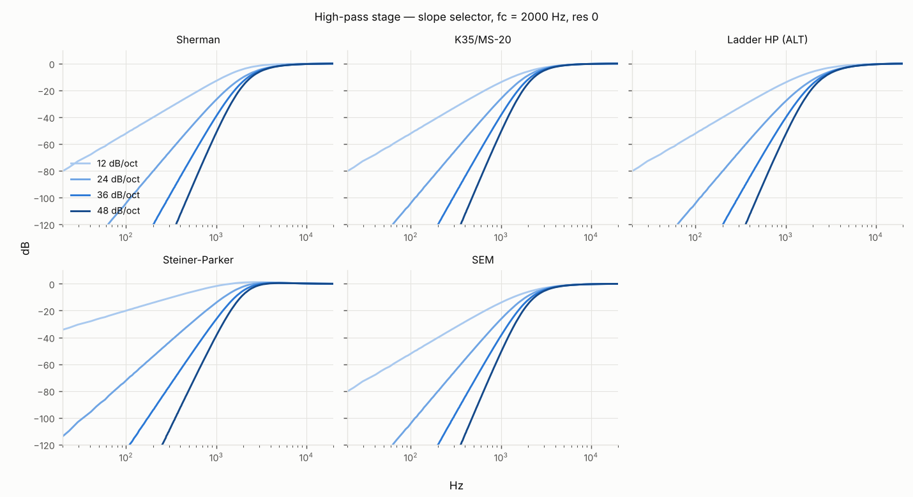
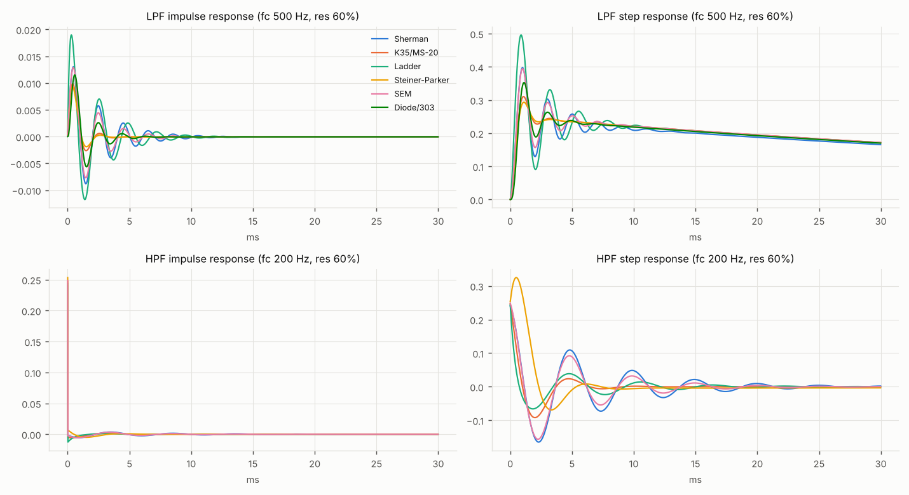
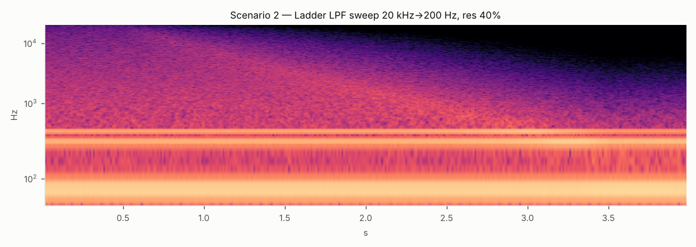
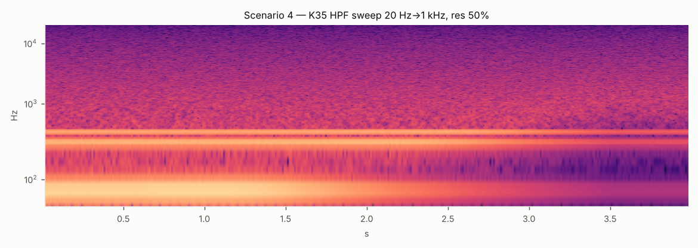

# Validation report

**25 / 25 checks passed.** Generated by `tests/validate.py` (run time 53.9 s).

## What was tested, and how

The gen~ code in the device is generated by `src/build_genexpr.py`. For testing, `tools/genexpr2c.py` parses that exact GenExpr text and translates it to C. The C is compiled and driven sample by sample by `tests/harness.c`. Parameter changes arrive at given sample positions, the same way Live's messages reach gen~. Every number below comes from running the shipping DSP code, not a separate model of it.

The transpiler also acts as a static checker. It rejects undeclared names, block-scope violations, wrong argument or return counts, assignments to Params or function arguments, and any History read after it has been written in the same sample. It caught one real bug during development: a local variable that shadowed a Param.

**Not covered by these tests** (they need Max/Live itself): Max's own gen~ compiler accepting the code, the device loading in Live, the UI appearance, Live's parameter and automation plumbing, MIDI mapping in Live, and device-bypass behaviour. See *Manual test checklist* at the end.

## Results

| | Check | Result |
|---|---|---|
| ✅ | Circuit reference: small-signal response matches each circuit's analogue transfer function (99th-pct error < 0.5 dB) | worst SEM HP 0.045 dB |
| ✅ | Passband integrity (bass for LPF @40 Hz, treble for HPF @15 kHz, res 0–70%, Comp 100%) | all within ±1 dB |
| ✅ | Slope selector: measured slope (4–8× fc) within ±4 dB/oct of effective slope (diode & Steiner HP: native + 12 per extension) | ok |
| ✅ | Cutoff tracking: resonant peak within ±100 cents of the set cutoff (res 85%) | ok |
| ✅ | Impulse decay and step settling (LPF passes DC, HPF removes it) | ok |
| ✅ | Self-oscillation: stable, bounded (<+2 dBFS), on pitch (±100 c); SEM does not self-oscillate (by design) | ok |
| ✅ | Nonlinearity: harmonic content rises with drive, output bounded (<+6 dBFS) | THD monotonic in drive, bounded |
| ✅ | Oversampling: 2x reduces aliasing for every model (7 kHz sine, drive 100%) | Sherman -10.5→-22.8 dB, K35/MS-20 -12.3→-26.2 dB, Ladder 3.7→-15.1 dB, Steiner-Parker -10.2→-38.0 dB, SEM -19.8→-49.5 dB, Diode/303 -13.4→-26.7 dB |
| ✅ | Stereo: identical L/R in → bit-identical out; zero crosstalk; channels independent (all models, 1x & 2x) | ok |
| ✅ | Click/zipper: >8 kHz burst after every abrupt change below −60 dBFS on a −6 dBFS sine (hard discontinuity = -30.1 dBFS) | 71 cases, worst -70.4 dBFS |
| ✅ | 1. LPF fully open + HPF fully closed: magnitude flat 20 Hz–20 kHz within ±0.1 dB | max deviation 0.029 dB |
| ✅ | 2. LPF sweep 20 kHz→200 Hz (3 s, 10 ms automation steps) | peak -5.4 dBFS |
| ✅ | 3. LPF at maximum resonance with program input, all models (soft clip OFF) | Sherman 2.4, K35/MS-20 1.7, Ladder 1.0, Steiner-Parker -2.8, SEM -7.8, Diode/303 -3.3 dBFS peak |
| ✅ | 4. HPF sweep 20 Hz→1 kHz | peak -6.7 dBFS |
| ✅ | 5. Sudden HPF cutoff changes (20 Hz↔600 Hz every 250 ms) | worst >8 kHz burst -79.0 dBFS |
| ✅ | 6. Both filters active and sweeping toward each other | peak -1.3 dBFS |
| ✅ | 7. Stereo input with different L/R content | left output independent of right input |
| ✅ | 8. Rapid manual movement (random LPF jumps every 5 ms, 3 s) | peak -7.7 dBFS, no NaN/Inf |
| ✅ | 9. Automation at Live's block rate (64-sample steps) vs sample-accurate ramp | difference -37.7 dB; >8 kHz energy +0.00 dB vs sample-accurate (no zipper) |
| ✅ | 10. MIDI CC (7-bit) stepping of cutoff, one step per 8 ms | worst >8 kHz burst -140.9 dBFS (no zipper) |
| ✅ | Sample-rate independence 44.1–192 kHz: tuning and stability | ok |
| ✅ | CPU benchmark (transpiled C, gcc -O2, this machine) | Both stages off (pass-through): 1.34%; Default device (Ladder LPF 24 dB + K35 HPF), 1x: 2.19%; Diode LPF 48 dB + Sherman HPF 48 dB, 1x: 3.46%; Default device, 2x oversampling: 3.07%; Worst case: Diode+Sherman 48 dB, 2x, both mid-crossfade: 6.64% |
| ✅ | Denormals: decay tails flush to zero; silence costs no more than signal | silence/signal CPU ratio 0.58 |
| ✅ | DC offset at output with asymmetric saturation (drive 100%, hot input) | worst residual DC -186.7 dBFS |
| ✅ | 30 s stress run: random changes to every parameter, hot input, soft clip ON | peak -0.00 dBFS, finite=True |

## Circuit reference: device vs. each circuit's transfer function

Each model's small-signal response compared with the analogue transfer function of the circuit it is derived from, mapped through the bilinear transform with the model's own prewarped cutoff. Compensation is set to 0 so no makeup gain alters the circuit's own gain. A TPT/zero-delay-feedback implementation of a circuit should agree with that circuit's equations to within measurement noise, and it does. Sources for every reference are listed in MODELS.md.

| Reference transfer function | 99th-percentile error | median error |
|---|---|---|
| Ladder LP 24 — Stilson & Smith / Stinchcombe 1/((1+s)^4+k), res 0% | 0.024 dB | 0.0038 dB |
| Ladder HP ALT — pole-mix s^4/((1+s)^4+k), res 0% | 0.028 dB | 0.0011 dB |
| Korg 35 LP — 1/(s^2+(2-K)s+1), res 0% | 0.009 dB | 0.0014 dB |
| Korg 35 HP — s^2/(s^2+(2-K)s+1), res 0% | 0.019 dB | 0.0011 dB |
| Steiner-Parker LP — Sallen-Key K/(s^2+(3-K)s+1), res 0% | 0.009 dB | 0.0014 dB |
| Steiner-Parker HP injection — K s(s+2)/(s^2+(3-K)s+1), res 0% | 0.008 dB | 0.0011 dB |
| SEM LP — SVF 1/(s^2+2Rs+1), res 0% | 0.009 dB | 0.0014 dB |
| SEM HP — SVF s^2/(s^2+2Rs+1), res 0% | 0.019 dB | 0.0011 dB |
| TB-303 — Stinchcombe 303 ladder (bottom C/2) + feedback HPF, res 0% | 0.006 dB | 0.0014 dB |
| Ladder LP 24 — Stilson & Smith / Stinchcombe 1/((1+s)^4+k), res 60% | 0.03 dB | 0.0039 dB |
| Ladder HP ALT — pole-mix s^4/((1+s)^4+k), res 60% | 0.022 dB | 0.0011 dB |
| Korg 35 LP — 1/(s^2+(2-K)s+1), res 60% | 0.011 dB | 0.0014 dB |
| Korg 35 HP — s^2/(s^2+(2-K)s+1), res 60% | 0.025 dB | 0.0011 dB |
| Steiner-Parker LP — Sallen-Key K/(s^2+(3-K)s+1), res 60% | 0.01 dB | 0.0014 dB |
| Steiner-Parker HP injection — K s(s+2)/(s^2+(3-K)s+1), res 60% | 0.017 dB | 0.0011 dB |
| SEM LP — SVF 1/(s^2+2Rs+1), res 60% | 0.017 dB | 0.0014 dB |
| SEM HP — SVF s^2/(s^2+2Rs+1), res 60% | 0.045 dB | 0.0011 dB |
| TB-303 — Stinchcombe 303 ladder (bottom C/2) + feedback HPF, res 60% | 0.025 dB | 0.0031 dB |

The TB-303 reference is the linear ladder with a current-driven bottom node, the bottom capacitor halved and one diode rung at the top. Its characteristic polynomial, after frequency scaling, is s⁴ + 6.727 s³ + 14.142 s² + 9.514 s + 1, coefficient for coefficient the polynomial Stinchcombe derives for the TB-303 configuration.

## Frequency response

Small-signal transfer functions (white noise at −60 dBFS, cross-spectral estimate).

**Low-pass stage, all six models, resonance 0/40/70/88 %**

**High-pass stage, five models, resonance 0/40/70/88 %**

**Low-pass slope selector 12/24/36/48 dB/oct**

**High-pass slope selector 12/24/36/48 dB/oct**

Reading the plots:

- **Ladder at 12 dB (pole-2 tap):** feedback is still taken from pole 4, as on Xpander-style multimode ladders, so the resonant peak sits on a 12 dB slope.
- **Diode/303:** the four coupled poles are widely spread. At zero resonance the slope near the cutoff is gentle (about 9 dB/oct between 4× and 8× fc) and steepens further out. This is the coupled-ladder behaviour, not an error, and it is why there is no 12 dB option for this model. Each linear extension adds exactly 12 dB/oct.

### Measured slopes (dB/oct, between 4× and 8× fc for LPF; fc/8 to fc/4 for HPF)

| Stage | Model | 12 | 24 | 36 | 48 |
|---|---|---|---|---|---|
| LPF | Sherman | 12.3 | 24.2 | 36.6 | 48.8 |
| LPF | K35/MS-20 | 12.0 | 24.4 | 36.7 | 48.9 |
| LPF | Ladder | 12.0 | 24.0 | 36.3 | 48.4 |
| LPF | Steiner-Parker | 12.0 | 24.3 | 36.7 | 49.0 |
| LPF | SEM | 12.0 | 24.3 | 36.7 | 49.0 |
| LPF | Diode/303 | 8.9 | 8.9 | 21.3 | 33.7 |
| HPF | Sherman | 11.7 | 23.1 | 34.8 | 45.8 |
| HPF | K35/MS-20 | 11.4 | 23.2 | 35.0 | 46.7 |
| HPF | Ladder HP (ALT) | 11.4 | 22.8 | 34.6 | 46.9 |
| HPF | Steiner-Parker | 5.6 | 17.3 | 29.1 | 40.8 |
| HPF | SEM | 11.4 | 23.2 | 35.0 | 46.9 |

## Cutoff tracking (resonance 85 %)

Error of the resonant-peak frequency against the cutoff setting, in cents (100 cents = 1 semitone). The estimate resolves about 5.9 Hz, so very low cutoffs show quantisation.

| OS | Stage | Model | 40 Hz | 100 Hz | 300 Hz | 1000 Hz | 3000 Hz | 8000 Hz |
|---|---|---|---|---|---|---|---|---|
| 1x | LPF | Sherman |  | -7 | -7 | +3 | +0 | +0 |
| 1x | LPF | K35/MS-20 |  | -7 | -7 | -27 | -31 | -18 |
| 1x | LPF | Ladder |  | -7 | -76 | -58 | -62 | -52 |
| 1x | LPF | Steiner-Parker |  | -7 | -7 | -38 | -41 | -34 |
| 1x | LPF | SEM |  | -7 | -7 | -17 | -17 | -9 |
| 1x | LPF | Diode/303 |  | +92 | +27 | +24 | +20 | +18 |
| 1x | HPF | Sherman | +43 | -7 | -7 | +3 |  |  |
| 1x | HPF | K35/MS-20 | +43 | +92 | +27 | +24 |  |  |
| 1x | HPF | Ladder HP (ALT) | +43 | -7 | -76 | -58 |  |  |
| 1x | HPF | Steiner-Parker | +43 | -7 | +27 | +13 |  |  |
| 1x | HPF | SEM | +43 | -7 | +27 | +13 |  |  |
| 2x | LPF | Sherman |  | -7 | -7 | +3 | +0 | +0 |
| 2x | LPF | K35/MS-20 |  | -7 | -7 | -27 | -38 | -34 |
| 2x | LPF | Ladder |  | -7 | -76 | -58 | -62 | -56 |
| 2x | LPF | Steiner-Parker |  | -7 | -7 | -38 | -41 | -34 |
| 2x | LPF | SEM |  | -7 | -7 | -17 | -17 | -9 |
| 2x | LPF | Diode/303 |  | +92 | +27 | +24 | +20 | +18 |
| 2x | HPF | Sherman | +43 | -7 | -7 | +3 |  |  |
| 2x | HPF | K35/MS-20 | +43 | +92 | +27 | +24 |  |  |
| 2x | HPF | Ladder HP (ALT) | +43 | -7 | -76 | -58 |  |  |
| 2x | HPF | Steiner-Parker | +43 | -7 | +27 | +13 |  |  |
| 2x | HPF | SEM | +43 | -7 | +27 | +13 |  |  |

Below self-oscillation the ladder's peak sits slightly under the cutoff (up to about −80 cents at 85 % resonance) and converges on it as resonance approaches 100 %, as the circuit's transfer function predicts.

## Self-oscillation (resonance 100 %)

| OS | Stage | Model | fc | Oscillates | Peak dBFS | Frequency | Error (cents) |
|---|---|---|---|---|---|---|---|
| 1x | LPF | Sherman | 100 | yes | -0.5 | 100.0 | 0 |
| 1x | LPF | Sherman | 1000 | yes | -0.5 | 1005.0 | 9 |
| 1x | LPF | Sherman | 5000 | yes | 0.7 | 5159.0 | 54 |
| 1x | LPF | K35/MS-20 | 100 | yes | -1.0 | 100.0 | 0 |
| 1x | LPF | K35/MS-20 | 1000 | yes | -0.6 | 1000.0 | 0 |
| 1x | LPF | K35/MS-20 | 5000 | yes | 0.9 | 5007.0 | 2 |
| 1x | LPF | Ladder | 100 | yes | -2.5 | 98.0 | -35 |
| 1x | LPF | Ladder | 1000 | yes | -3.0 | 990.0 | -17 |
| 1x | LPF | Ladder | 5000 | yes | -3.7 | 5015.0 | 5 |
| 1x | LPF | Steiner-Parker | 100 | yes | -5.4 | 100.0 | 0 |
| 1x | LPF | Steiner-Parker | 1000 | yes | -5.3 | 1000.0 | 0 |
| 1x | LPF | Steiner-Parker | 5000 | yes | -4.0 | 5080.0 | 27 |
| 1x | LPF | SEM | 100 | no | -240.0 | - | - |
| 1x | LPF | SEM | 1000 | no | -240.0 | - | - |
| 1x | LPF | SEM | 5000 | no | -240.0 | - | - |
| 1x | LPF | Diode/303 | 100 | yes | -17.0 | 103.0 | 51 |
| 1x | LPF | Diode/303 | 1000 | yes | -9.8 | 966.0 | -60 |
| 1x | LPF | Diode/303 | 5000 | yes | -10.0 | 4850.0 | -53 |
| 1x | HPF | Sherman | 60 | yes | -0.4 | 60.0 | 0 |
| 1x | HPF | Sherman | 300 | yes | -0.4 | 300.0 | 0 |
| 1x | HPF | Sherman | 1500 | yes | -0.4 | 1513.0 | 15 |
| 1x | HPF | K35/MS-20 | 60 | yes | -0.8 | 60.0 | 0 |
| 1x | HPF | K35/MS-20 | 300 | yes | -0.7 | 300.0 | 0 |
| 1x | HPF | K35/MS-20 | 1500 | yes | -0.1 | 1500.0 | 0 |
| 1x | HPF | Ladder HP (ALT) | 60 | yes | -1.7 | 59.0 | -29 |
| 1x | HPF | Ladder HP (ALT) | 300 | yes | -1.9 | 296.0 | -23 |
| 1x | HPF | Ladder HP (ALT) | 1500 | yes | -2.6 | 1489.0 | -13 |
| 1x | HPF | Steiner-Parker | 60 | yes | -5.4 | 60.0 | 0 |
| 1x | HPF | Steiner-Parker | 300 | yes | -5.4 | 299.0 | -6 |
| 1x | HPF | Steiner-Parker | 1500 | yes | -5.3 | 1503.0 | 3 |
| 1x | HPF | SEM | 60 | no | -240.0 | - | - |
| 1x | HPF | SEM | 300 | no | -240.0 | - | - |
| 1x | HPF | SEM | 1500 | no | -240.0 | - | - |
| 2x | LPF | Sherman | 100 | yes | -0.5 | 100.0 | 0 |
| 2x | LPF | Sherman | 1000 | yes | -0.5 | 1002.0 | 3 |
| 2x | LPF | Sherman | 5000 | yes | -0.4 | 5080.0 | 27 |
| 2x | LPF | K35/MS-20 | 100 | yes | -1.0 | 100.0 | 0 |
| 2x | LPF | K35/MS-20 | 1000 | yes | -0.8 | 1000.0 | 0 |
| 2x | LPF | K35/MS-20 | 5000 | yes | 0.0 | 5003.0 | 1 |
| 2x | LPF | Ladder | 100 | yes | -2.4 | 98.0 | -35 |
| 2x | LPF | Ladder | 1000 | yes | -2.7 | 987.0 | -23 |
| 2x | LPF | Ladder | 5000 | yes | -3.6 | 4983.0 | -6 |
| 2x | LPF | Steiner-Parker | 100 | yes | -5.4 | 100.0 | 0 |
| 2x | LPF | Steiner-Parker | 1000 | yes | -5.4 | 998.0 | -3 |
| 2x | LPF | Steiner-Parker | 5000 | yes | -5.0 | 5033.0 | 11 |
| 2x | LPF | SEM | 100 | no | -240.0 | - | - |
| 2x | LPF | SEM | 1000 | no | -240.0 | - | - |
| 2x | LPF | SEM | 5000 | no | -240.0 | - | - |
| 2x | LPF | Diode/303 | 100 | yes | -16.9 | 103.0 | 51 |
| 2x | LPF | Diode/303 | 1000 | yes | -9.7 | 965.0 | -62 |
| 2x | LPF | Diode/303 | 5000 | yes | -9.7 | 4819.0 | -64 |
| 2x | HPF | Sherman | 60 | yes | -0.4 | 60.0 | 0 |
| 2x | HPF | Sherman | 300 | yes | -0.4 | 300.0 | 0 |
| 2x | HPF | Sherman | 1500 | yes | -0.4 | 1506.0 | 7 |
| 2x | HPF | K35/MS-20 | 60 | yes | -0.8 | 60.0 | 0 |
| 2x | HPF | K35/MS-20 | 300 | yes | -0.8 | 300.0 | 0 |
| 2x | HPF | K35/MS-20 | 1500 | yes | -0.5 | 1500.0 | 0 |
| 2x | HPF | Ladder HP (ALT) | 60 | yes | -1.7 | 59.0 | -29 |
| 2x | HPF | Ladder HP (ALT) | 300 | yes | -1.8 | 295.0 | -29 |
| 2x | HPF | Ladder HP (ALT) | 1500 | yes | -2.2 | 1483.0 | -20 |
| 2x | HPF | Steiner-Parker | 60 | yes | -5.4 | 60.0 | 0 |
| 2x | HPF | Steiner-Parker | 300 | yes | -5.4 | 299.0 | -6 |
| 2x | HPF | Steiner-Parker | 1500 | yes | -5.4 | 1499.0 | -1 |
| 2x | HPF | SEM | 60 | no | -240.0 | - | - |
| 2x | HPF | SEM | 300 | no | -240.0 | - | - |
| 2x | HPF | SEM | 1500 | no | -240.0 | - | - |

The SEM model is deliberately limited to Q ≈ 10 and does not self-oscillate, matching the original circuit's reputation for controlled resonance.

## Impulse and step response

## Nonlinear behaviour

| Model | Drive | THD % | Even harmonics (dB re fundamental) | Peak out |
|---|---|---|---|---|
| Sherman | 0 % | 3.337 | -29.6 | 0.513 |
| Sherman | 50 % | 14.362 | -17.8 | 1.029 |
| Sherman | 100 % | 37.305 | -20.7 | 0.526 |
| K35/MS-20 | 0 % | 0.171 | -184.8 | 0.497 |
| K35/MS-20 | 50 % | 4.823 | -180.6 | 0.981 |
| K35/MS-20 | 100 % | 32.604 | -178.8 | 0.609 |
| Ladder | 0 % | 0.024 | -178.9 | 0.503 |
| Ladder | 50 % | 1.613 | -181.1 | 1.216 |
| Ladder | 100 % | 31.567 | -179.7 | 1.148 |
| Steiner-Parker | 0 % | 0.21 | -182.0 | 0.496 |
| Steiner-Parker | 50 % | 5.259 | -181.0 | 0.966 |
| Steiner-Parker | 100 % | 29.208 | -177.9 | 0.686 |
| SEM | 0 % | 0.033 | -180.7 | 0.5 |
| SEM | 50 % | 1.024 | -179.5 | 1.144 |
| SEM | 100 % | 17.601 | -180.1 | 1.365 |
| Diode/303 | 0 % | 0.129 | -178.8 | 0.495 |
| Diode/303 | 50 % | 3.687 | -179.9 | 1.02 |
| Diode/303 | 100 % | 29.711 | -178.3 | 0.71 |

Only Sherman produces even harmonics, from its asymmetric input clipper. The other circuits are balanced (differential pairs, OTAs, symmetric diode strings), so they produce odd harmonics only.

### Aliasing, 1x vs 2x oversampling (7 kHz sine at −3 dBFS, drive 100 %, 48 kHz)

Aliased (non-harmonic) energy relative to the fundamental:

| Model | 1x | 2x |
|---|---|---|
| Sherman | -10.5 dB | -22.8 dB |
| K35/MS-20 | -12.3 dB | -26.2 dB |
| Ladder | 3.7 dB | -15.1 dB |
| Steiner-Parker | -10.2 dB | -38.0 dB |
| SEM | -19.8 dB | -49.5 dB |
| Diode/303 | -13.4 dB | -26.7 dB |

This is a deliberately extreme test signal. Use 2x for heavy drive on bright material.

## Click and zipper tests

Each case makes an instant parameter jump on a steady 110 Hz sine at −6 dBFS, then measures energy above 8 kHz in the 6 ms after the jump. For scale, a hard polarity discontinuity of the same sine measures **-30.1 dBFS** on this metric. Pass threshold: −60 dBFS.

| Case | >8 kHz burst (dBFS) | vs. quiet reference (dB) |
|---|---|---|
| LPF Sherman: cutoff 20 kHz→200 Hz | -112.2 | +46.2 |
| LPF Sherman: cutoff 200 Hz→20 kHz | -106.0 | +49.0 |
| LPF Sherman: resonance 0→100% | -143.2 | +15.4 |
| LPF Sherman: slope 12→48 | -112.4 | +45.9 |
| LPF Sherman: drive 0→100% | -111.2 | +47.1 |
| LPF Sherman: character 0→100% | -150.6 | +7.6 |
| LPF Sherman: stage off | -114.6 | +42.3 |
| LPF model switch Sherman→K35/MS-20 | -123.9 | +34.0 |
| LPF K35/MS-20: cutoff 20 kHz→200 Hz | -110.5 | +47.8 |
| LPF K35/MS-20: cutoff 200 Hz→20 kHz | -115.1 | +42.4 |
| LPF K35/MS-20: resonance 0→100% | -128.5 | +31.2 |
| LPF K35/MS-20: slope 12→48 | -107.0 | +52.6 |
| LPF K35/MS-20: drive 0→100% | -105.7 | +53.9 |
| LPF K35/MS-20: character 0→100% | -160.2 | -0.7 |
| LPF K35/MS-20: stage off | -104.5 | +53.7 |
| LPF model switch K35/MS-20→Ladder | -115.6 | +43.2 |
| LPF Ladder: cutoff 20 kHz→200 Hz | -114.8 | +43.5 |
| LPF Ladder: cutoff 200 Hz→20 kHz | -103.3 | +47.1 |
| LPF Ladder: resonance 0→100% | -144.0 | +15.7 |
| LPF Ladder: slope 12→48 | -102.8 | +55.6 |
| LPF Ladder: drive 0→100% | -121.3 | +37.1 |
| LPF Ladder: character 0→100% | -158.8 | -0.4 |
| LPF Ladder: stage off | -105.0 | +47.8 |
| LPF model switch Ladder→Steiner-Parker | -118.1 | +39.5 |
| LPF Steiner-Parker: cutoff 20 kHz→200 Hz | -109.3 | +49.0 |
| LPF Steiner-Parker: cutoff 200 Hz→20 kHz | -116.4 | +41.4 |
| LPF Steiner-Parker: resonance 0→100% | -138.6 | +21.2 |
| LPF Steiner-Parker: slope 12→48 | -106.1 | +53.4 |
| LPF Steiner-Parker: drive 0→100% | -104.8 | +54.6 |
| LPF Steiner-Parker: character 0→100% | -145.9 | +13.5 |
| LPF Steiner-Parker: stage off | -103.1 | +53.6 |
| LPF model switch Steiner-Parker→SEM | -114.4 | +43.9 |
| LPF SEM: cutoff 20 kHz→200 Hz | -117.0 | +41.3 |
| LPF SEM: cutoff 200 Hz→20 kHz | -108.7 | +47.5 |
| LPF SEM: resonance 0→100% | -138.6 | +21.2 |
| LPF SEM: slope 12→48 | -112.0 | +47.0 |
| LPF SEM: drive 0→100% | -110.7 | +48.3 |
| LPF SEM: character 0→100% | -149.5 | +9.5 |
| LPF SEM: stage off | -111.6 | +46.4 |
| LPF model switch SEM→Diode/303 | -121.8 | +36.8 |
| LPF Diode/303: cutoff 20 kHz→200 Hz | -110.0 | +48.4 |
| LPF Diode/303: cutoff 200 Hz→20 kHz | -114.2 | +43.1 |
| LPF Diode/303: resonance 0→100% | -110.4 | +49.4 |
| LPF Diode/303: slope 12→48 | -106.8 | +52.9 |
| LPF Diode/303: drive 0→100% | -105.5 | +54.1 |
| LPF Diode/303: character 0→100% | -160.4 | -0.7 |
| LPF Diode/303: stage off | -103.6 | +54.9 |
| LPF model switch Diode/303→Sherman | -114.7 | +44.4 |
| HPF Sherman: cutoff 20 Hz→1 kHz | -79.6 | +78.8 |
| HPF Sherman: cutoff 1 kHz→20 Hz | -115.0 | +49.4 |
| HPF model switch Sherman→K35/MS-20 | -101.3 | +48.9 |
| HPF Sherman: stage on | -152.9 | +5.4 |
| HPF K35/MS-20: cutoff 20 Hz→1 kHz | -75.2 | +83.2 |
| HPF K35/MS-20: cutoff 1 kHz→20 Hz | -115.2 | +49.2 |
| HPF model switch K35/MS-20→Ladder HP (ALT) | -99.9 | +55.4 |
| HPF K35/MS-20: stage on | -152.8 | +5.5 |
| HPF Ladder HP (ALT): cutoff 20 Hz→1 kHz | -70.4 | +88.0 |
| HPF Ladder HP (ALT): cutoff 1 kHz→20 Hz | -115.6 | +48.8 |
| HPF model switch Ladder HP (ALT)→Steiner-Parker | -103.1 | +56.1 |
| HPF Ladder HP (ALT): stage on | -147.2 | +11.2 |
| HPF Steiner-Parker: cutoff 20 Hz→1 kHz | -78.1 | +80.3 |
| HPF Steiner-Parker: cutoff 1 kHz→20 Hz | -115.0 | +48.7 |
| HPF model switch Steiner-Parker→SEM | -130.2 | +19.5 |
| HPF Steiner-Parker: stage on | -150.6 | +7.7 |
| HPF SEM: cutoff 20 Hz→1 kHz | -81.6 | +76.8 |
| HPF SEM: cutoff 1 kHz→20 Hz | -115.1 | +49.3 |
| HPF model switch SEM→Sherman | -101.7 | +51.9 |
| HPF SEM: stage on | -153.7 | +4.7 |
| Stage order LP→HP to HP→LP | -75.2 | +47.4 |
| Oversampling 1x→2x | -74.7 | +47.9 |
| Output level −24→+6 dB | -86.7 | +35.9 |

## Sweeps

## Sample rates

| Sample rate | Model | Stage | fc | Peak error (cents) | Self-osc peak dBFS |
|---|---|---|---|---|---|
| 44100 | Ladder | LPF | 1000 | -64 | -3.1 |
| 44100 | Ladder | LPF | 10000 | -42 | 0.6 |
| 44100 | Diode/303 | LPF | 1000 | +30 | -9.8 |
| 44100 | Diode/303 | LPF | 10000 | +15 | -10.8 |
| 44100 | Steiner-Parker | LPF | 1000 | -64 | -5.3 |
| 44100 | Steiner-Parker | LPF | 10000 | -25 | -0.4 |
| 44100 | K35/MS-20 | HPF | 100 | +39 | -0.8 |
| 44100 | K35/MS-20 | HPF | 1000 | +30 | -0.3 |
| 48000 | Ladder | LPF | 1000 | -58 | -3.0 |
| 48000 | Ladder | LPF | 10000 | -46 | -0.5 |
| 48000 | Diode/303 | LPF | 1000 | +24 | -9.8 |
| 48000 | Diode/303 | LPF | 10000 | +14 | -10.6 |
| 48000 | Steiner-Parker | LPF | 1000 | -38 | -5.3 |
| 48000 | Steiner-Parker | LPF | 10000 | -27 | -1.0 |
| 48000 | K35/MS-20 | HPF | 100 | +92 | -0.8 |
| 48000 | K35/MS-20 | HPF | 1000 | +24 | -0.4 |
| 88200 | Ladder | LPF | 1000 | -55 | -2.8 |
| 88200 | Ladder | LPF | 10000 | -55 | -3.7 |
| 88200 | Diode/303 | LPF | 1000 | +21 | -9.7 |
| 88200 | Diode/303 | LPF | 10000 | +19 | -10.0 |
| 88200 | Steiner-Parker | LPF | 1000 | -16 | -5.4 |
| 88200 | Steiner-Parker | LPF | 10000 | -33 | -3.8 |
| 88200 | K35/MS-20 | HPF | 100 | +128 | -0.8 |
| 88200 | K35/MS-20 | HPF | 1000 | +39 | -0.6 |
| 96000 | Ladder | LPF | 1000 | -48 | -2.7 |
| 96000 | Ladder | LPF | 10000 | -54 | -3.7 |
| 96000 | Diode/303 | LPF | 1000 | +13 | -9.7 |
| 96000 | Diode/303 | LPF | 10000 | +22 | -10.0 |
| 96000 | Steiner-Parker | LPF | 1000 | -27 | -5.4 |
| 96000 | Steiner-Parker | LPF | 10000 | -38 | -4.0 |
| 96000 | K35/MS-20 | HPF | 100 | +92 | -0.8 |
| 96000 | K35/MS-20 | HPF | 1000 | +33 | -0.6 |
| 192000 | Ladder | LPF | 1000 | -69 | -2.6 |
| 192000 | Ladder | LPF | 10000 | -61 | -3.6 |
| 192000 | Diode/303 | LPF | 1000 | +13 | -9.7 |
| 192000 | Diode/303 | LPF | 10000 | +17 | -9.6 |
| 192000 | Steiner-Parker | LPF | 1000 | -27 | -5.4 |
| 192000 | Steiner-Parker | LPF | 10000 | -31 | -5.1 |
| 192000 | K35/MS-20 | HPF | 100 | +275 | -0.8 |
| 192000 | K35/MS-20 | HPF | 1000 | +13 | -0.7 |

All coefficients are recomputed from `samplerate` on every sample. A sample-rate change therefore needs no reinitialisation and cannot leave stale coefficients.

## CPU benchmark

Transpiled C compiled with gcc -O2, single core, x86-64 cloud VM. gen~'s own code generator produces different machine code, so treat these as relative costs, not as Live's CPU meter.

| Configuration | ns per stereo frame | % of one core at 48 kHz |
|---|---|---|
| Both stages off (pass-through) | 279.9 | 1.34 % |
| Default device (Ladder LPF 24 dB + K35 HPF), 1x | 455.4 | 2.19 % |
| Diode LPF 48 dB + Sherman HPF 48 dB, 1x | 721.2 | 3.46 % |
| Default device, 2x oversampling | 640.1 | 3.07 % |
| Worst case: Diode+Sherman 48 dB, 2x, both mid-crossfade | 1383.4 | 6.64 % |

Inactive models cost nothing. A stage that is off, or parked in its OPEN zone, skips all model code.

## Manual test checklist (in Live)

- [ ] Device loads without errors in the Max console (Max window). The gen~ object compiles (no red error bar).
- [ ] All 20 parameters appear in Live's automation chooser with the names listed in PARAMETERS.md.
- [ ] Turn LPF CUTOFF fully clockwise and HPF CUTOFF fully anticlockwise: the signal should be audibly identical to the device bypassed.
- [ ] MIDI-map LPF CUTOFF and HPF CUTOFF (Cmd/Ctrl+M) to a controller and sweep fast: no zipper noise.
- [ ] Draw automation on LPF Cutoff and play it back: smooth sweep.
- [ ] Switch models during playback on a sustained sound: about 25 ms crossfade, no click.
- [ ] Switch Stage Order and Oversampling during playback: brief (≈8 ms) dip, no click.
- [ ] Toggle the device's on/off switch during playback.
- [ ] Change Live's sample rate (Preferences → Audio) with the device running.
- [ ] Save the Set, reopen it: all parameters restored, including model selections.
