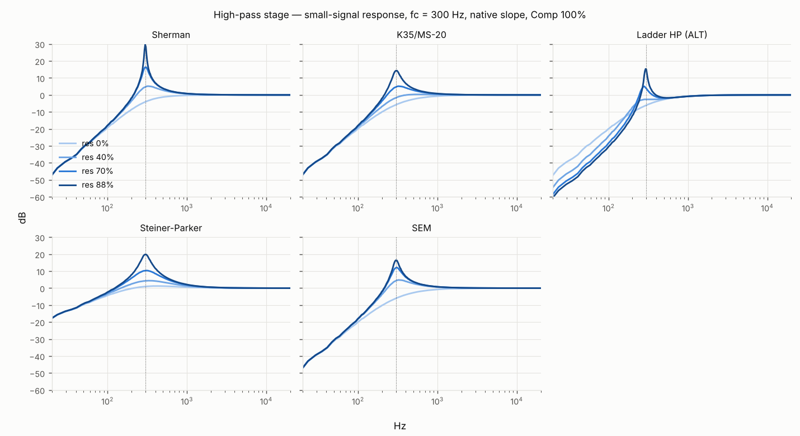
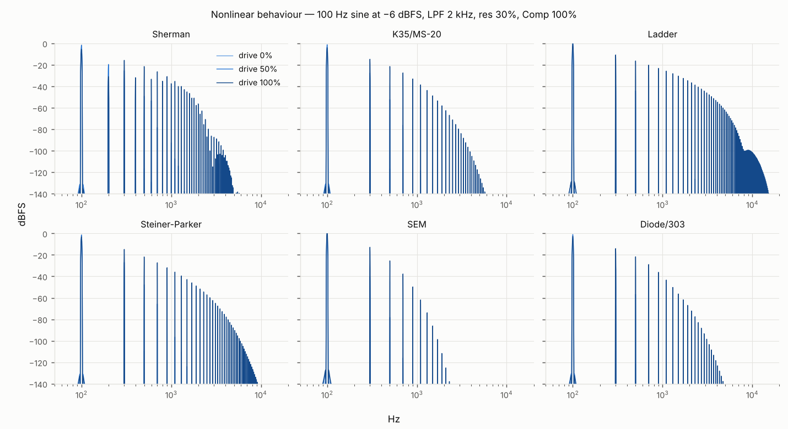
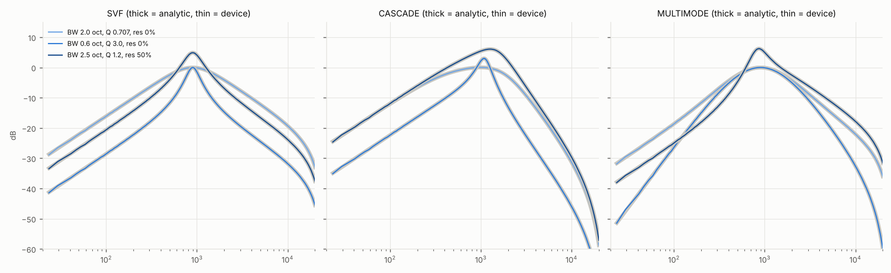
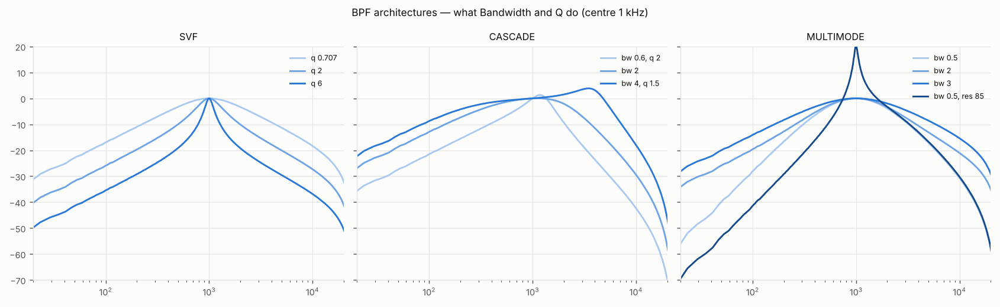
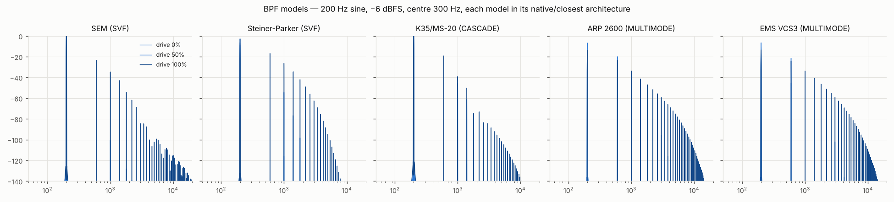
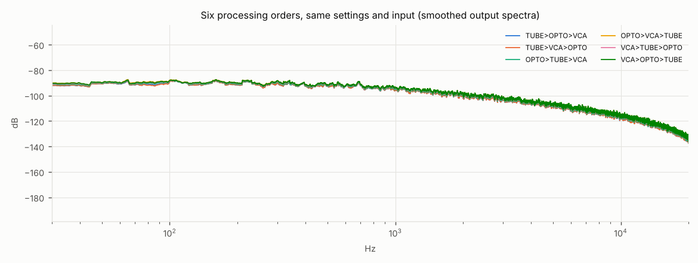
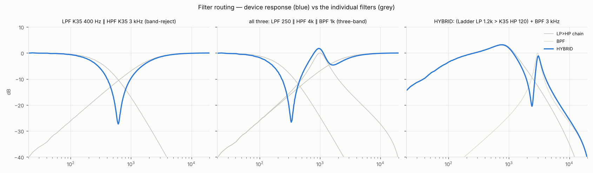

# Validation report

**95 / 95 checks passed.** Generated by `tests/validate.py` (run time 494.1 s).

## What was tested, and how

The gen~ code in the device is generated by `src/build_genexpr.py`. For testing, `tools/genexpr2c.py` parses that exact GenExpr text and translates it to C. The C is compiled and driven sample by sample by `tests/harness.c`. Parameter changes arrive at given sample positions, the same way Live's messages reach gen~. Every number below comes from running the shipping DSP code, not a separate model of it.

The transpiler also acts as a static checker. It rejects undeclared names, block-scope violations, wrong argument or return counts, assignments to Params or function arguments, and any History read after it has been written in the same sample. It caught one real bug during development: a local variable that shadowed a Param.

**Not covered by these tests** (they need Max/Live itself): Max's own gen~ compiler accepting the code, the device loading in Live, the UI appearance, Live's parameter and automation plumbing, MIDI mapping in Live, and device-bypass behaviour. See *Manual test checklist* at the end.

## Results

| | Check | Result |
|---|---|---|
| ✅ | Circuit reference: small-signal response matches each circuit's analogue transfer function (99th-pct error < 0.5 dB) | worst SEM HP 0.029 dB |
| ✅ | Passband integrity (bass for LPF @40 Hz, treble for HPF @15 kHz, res 0–70%, Comp 100%) | all within ±1 dB |
| ✅ | Slope selector: measured slope (4–8× fc) within ±4 dB/oct of effective slope (diode, Steiner HP and K35 HP: native + 12 per extension) | ok |
| ✅ | Cutoff tracking: resonant peak within ±100 cents of the set cutoff (res 85%; SEM: of its circuit-Q peak position; 904B HP: its -6 dB corner) | ok |
| ✅ | Impulse decay and step settling (LPF passes DC, HPF removes it) | ok |
| ✅ | Self-oscillation: stable, bounded (<+2 dBFS), on pitch (±100 c); SEM and Sherman do not sustain it and the 904B HP has no resonance (by design); Ladder not below ~120 Hz (Minimoog couplings) | ok |
| ✅ | Nonlinearity: harmonic content rises with drive, output bounded (<+6 dBFS) | THD monotonic in drive, bounded |
| ✅ | Oversampling: 2x reduces aliasing for every model (7 kHz sine, drive 100%) | Sherman -10.2→-23.0 dB, K35/MS-20 -12.3→-26.2 dB, Ladder 0.0→-18.2 dB, Steiner-Parker -12.1→-28.5 dB, SEM -15.2→-45.4 dB, Diode/303 -13.4→-26.7 dB |
| ✅ | Stereo: identical L/R in → bit-identical out; zero crosstalk; channels independent (all models, 1x & 2x) | ok |
| ✅ | Click/zipper: >8 kHz burst after every abrupt change below −60 dBFS on a −6 dBFS sine (hard discontinuity = -30.1 dBFS) | 71 cases, worst -70.4 dBFS |
| ✅ | 1. LPF fully open + HPF fully closed: magnitude flat 20 Hz–20 kHz within ±0.1 dB | max deviation 0.029 dB |
| ✅ | 2. LPF sweep 20 kHz→200 Hz (3 s, 10 ms automation steps) | peak -8.1 dBFS |
| ✅ | 3. LPF at maximum resonance with program input, all models (soft clip OFF) | Sherman -5.8, K35/MS-20 1.7, Ladder 2.4, Steiner-Parker -2.9, SEM -7.8, Diode/303 -3.3 dBFS peak |
| ✅ | 4. HPF sweep 20 Hz→1 kHz | peak -5.8 dBFS |
| ✅ | 5. Sudden HPF cutoff changes (20 Hz↔600 Hz every 250 ms) | worst >8 kHz burst -71.8 dBFS |
| ✅ | 6. Both filters active and sweeping toward each other | peak -1.2 dBFS |
| ✅ | 7. Stereo input with different L/R content | left output independent of right input |
| ✅ | 8. Rapid manual movement (random LPF jumps every 5 ms, 3 s) | peak -7.7 dBFS, no NaN/Inf |
| ✅ | 9. Automation at Live's block rate (64-sample steps) vs sample-accurate ramp | difference -42.7 dB; >8 kHz energy +0.00 dB vs sample-accurate (no zipper) |
| ✅ | 10. MIDI CC (7-bit) stepping of cutoff, one step per 8 ms | worst >8 kHz burst -146.3 dBFS (no zipper) |
| ✅ | Sample-rate independence 44.1–192 kHz: tuning and stability | ok |
| ✅ | CPU benchmark (transpiled C, gcc -O2, this machine) | Both stages off (pass-through): 8.52%; Default device (Ladder LPF 24 dB + K35 HPF), 1x: 10.5%; Diode LPF 48 dB + Sherman HPF 48 dB, 1x: 11.32%; Default device, 2x oversampling: 13.27%; Worst case: Diode+Sherman 48 dB, 2x, both mid-crossfade: 18.63% |
| ✅ | Denormals: decay tails flush to zero; silence costs no more than signal | silence/signal CPU ratio 0.97 |
| ✅ | DC offset at output with asymmetric saturation (drive 100%, hot input) | worst residual DC -183.1 dBFS |
| ✅ | 30 s stress run: random changes to every parameter, hot input, soft clip ON | peak -0.00 dBFS, finite=True |
| ✅ | REGRESSION: LPF/HPF bit-exact against the v1.1 baseline except the documented v1.6 solver changes (BPF off; 48 scenarios) | 0/48 bit-identical to legacy; 48 documented v1.6 changes (match the v1.6 capture: True) |
| ✅ | REGRESSION: v1.1 presets/automation/MIDI maps — every v1.1 object, connection and gen~ Param unchanged | COMPATIBLE — new parameters (81): BPF On, BPF Model, BPF Architecture, BPF Centre, BPF Bandwidth, BPF Q, BPF Resonance, BPF Drive, BPF Compensation, BPF Mix, BPF Position, Chain Order, Key Listen, Tube On, Opto On, VCA On, Gate On, Tube Input, Tube Drive, Tube Bias, Tube Tone, Tube Mix, Tube Output, Tube Auto Gain, Opto Input, Opto Peak Reduction, Opto HF Emphasis, Opto SC HPF, Opto Link, Opto Mix, Opto Gain, Opto Mode, Opto SC Source, VCA Input, VCA Threshold, VCA Release, VCA SC HPF, VCA Link, VCA Mix, VCA Output, VCA Ratio, VCA Attack, VCA Knee, VCA Thrust, VCA Type, VCA Auto Makeup, VCA SC Source, Gate Threshold, Gate Attack, Gate Hold, Gate Release, Gate Range, Gate Key HPF, Gate Key LPF, Gate Key Source, Filter Routing, Parallel LPF Level, Parallel HPF Level, Parallel BPF Level, Engine Mode, High Oversampling, K35 Circuit, Sherman Modes, Sherman Balance, Sherman Correction, Sherman Harmonics, Sherman Limit, Sherman Clock, EnvF On, EnvF Mode, EnvF Range, EnvF Sweep, EnvF Peak, EnvF Gain, EnvF Attack, EnvF Release, EnvF Mix, EnvF Output, EnvF to LPF, EnvF to HPF, EnvF to BPF |
| ✅ | REGRESSION: BPF switched on at Mix 0 is bit-transparent to the LPF/HPF signal (48 scenarios × POST/PRE) | 102/102 bit-identical |
| ✅ | BPF: small-signal response of all 15 model×architecture configurations matches its analytic transfer function (99th pct < 0.5 dB) | 45 configurations, worst 0.060 dB |
| ✅ | BPF: bandwidth control (CASCADE −3 dB width tracks BW setting; SVF width follows Q) | CASCADE BW 1 oct: 1.49 oct; CASCADE BW 2 oct: 2.15 oct; CASCADE BW 3 oct: 3.03 oct; CASCADE BW 4 oct: 3.99 oct; SVF Q 0.707: 1.88 oct; SVF Q 2: 0.7 oct; SVF Q 5: 0.28 oct; MULTIMODE BW 0.5 (pole-mix order): 1.73 oct; MULTIMODE BW 2 (pole-mix order): 1.88 oct; MULTIMODE BW 3 (pole-mix order): 2.52 oct |
| ✅ | BPF: resonant peak tracks the centre frequency within ±100 cents (res 85%, all configurations) | worst 75 c above 200 Hz |
| ✅ | BPF: self-oscillation stable, bounded (<+2 dBFS) and on centre; SEM never self-oscillates (1x and 2x) | ok |
| ✅ | BPF: harmonic content rises with drive for every model; models are distinct (min RMS harmonic-profile distance > 1 dB) | monotonic=True, closest pair differs by 7.7 dB RMS |
| ✅ | BPF: click/zipper — >8 kHz burst after every abrupt BPF change below −60 dBFS (−6 dBFS sine) | 18 cases, worst -92.1 dBFS |
| ✅ | BPF: stereo — identical L/R → bit-identical out, zero crosstalk, independent channels (15 configurations) | ok |
| ✅ | COMBINED: LPF + HPF + BPF all active and sweeping, POST/PRE × 1x/2x | POST/1x peak -10.7 dBFS, POST/2x peak -10.7 dBFS, PRE/1x peak -10.5 dBFS, PRE/2x peak -10.5 dBFS |
| ✅ | COMBINED: 30 s stress — random changes to every LPF, HPF, BPF and global parameter, hot input | peak 0.00 dBFS, finite=True |
| ✅ | BPF automation: Live block-rate (64-sample) centre ramp vs sample-accurate | difference -55.2 dB, >8 kHz energy +0.00 dB |
| ✅ | BPF MIDI: 7-bit CC stepping of the centre (one step per 8 ms) — no zipper | worst >8 kHz burst -134.8 dBFS |
| ✅ | BPF: sample-rate independence 44.1–192 kHz (centre tracking) | ok |
| ✅ | BPF: decay tails flush to zero (no denormals) | max tail 0.0e+00 |
| ✅ | CPU with BPF (transpiled C, gcc -O2, this machine) | v1.1 default device (LPF+HPF), BPF off: 10.85%; + BPF SVF: 11.61%; + BPF CASCADE: 11.81%; + BPF MULTIMODE (ARP): 12.49%; worst: all three, 48 dB slopes, 2x, BPF mid-crossfade: 19.58% |
| ✅ | REGRESSION v1.3: LPF/HPF bit-exact vs v1.1 baseline except documented v1.6 changes (48 scenarios, dynamics off) | 0/48 bit-identical to legacy; 48 documented v1.6 changes (match the v1.6 capture: True) |
| ✅ | REGRESSION v1.3: BPF bit-exact vs v1.2 baseline except documented v1.6 changes (35 scenarios, dynamics off) | 0/35 bit-identical to legacy; 35 documented v1.6 changes (match the v1.6 capture: True) |
| ✅ | REGRESSION v1.3: presets/automation/MIDI of v1.1 devices intact (objects, connections, parameters, gen~ Params) | COMPATIBLE — [DubFilter_v1.1.maxpat] boxes checked: 89  connections: 111  parameters: 20 |
| ✅ | REGRESSION v1.3: presets/automation/MIDI of v1.2 devices intact (objects, connections, parameters, gen~ Params) | COMPATIBLE — [DubFilter_v1.2.maxpat] boxes checked: 136  connections: 178  parameters: 31 |
| ✅ | REGRESSION v1.3: Opto+VCA switched on at Mix 0 are bit-transparent (24 filter scenarios); TUBE at Mix 0 passes its phase-matched dry path (see LATENCY) | 24/24 bit-identical |
| ✅ | CHAIN: all six processing orders run (all modules on) — stable, bounded, audibly distinct, level spread < 6 dB | level spread across orders 1.07 dB; TUBE>OPTO>VCA -23.14 dBFS; TUBE>VCA>OPTO -23.29 dBFS; OPTO>TUBE>VCA -22.93 dBFS; OPTO>VCA>TUBE -22.22 dBFS; VCA>TUBE>OPTO -22.64 dBFS; VCA>OPTO>TUBE -22.41 dBFS |
| ✅ | CHAIN: real-time reordering — all 30 order transitions click-free (>8 kHz burst < −60 dBFS on a −6 dBFS sine, 25 ms crossfade) | worst -120.8 dBFS |
| ✅ | CHAIN: independent bypass — a bypassed module is fully transparent, does not affect the others, toggles click-free | orders equivalent without TUBE: True; VCA GR change when TUBE (downstream) bypassed: 0.00e+00 dB; worst toggle burst -125.9 dBFS |
| ✅ | GAIN STAGING: extreme settings (+12 dB into every module, max drive) — floating-point headroom, no internal clipping, output held by soft clip | TUBE>OPTO>VCA internal 5.6 dBFS / out -8.71; TUBE>VCA>OPTO internal 5.6 dBFS / out -8.71; OPTO>TUBE>VCA internal 5.6 dBFS / out -8.71; OPTO>VCA>TUBE internal 5.6 dBFS / out -8.71; VCA>TUBE>OPTO internal 5.6 dBFS / out -8.71; VCA>OPTO>TUBE internal 5.6 dBFS / out -8.71 |
| ✅ | GAIN STAGING: tube Auto Gain holds a −12 dBFS program level across the drive range (±2 dB) | levels -12.0, -12.0, -11.7, -10.8, -9.7 dBFS |
| ✅ | GAIN STAGING: per-module input/output gain and level meters (VCA in +6 dB, out −3 dB on a −10 dBFS tone) | meter in -4.00 dBFS, out -19.08 dBFS, GR 12.08 dB |
| ✅ | TUBE: harmonic content rises with drive; bias produces even harmonics; no DC at the output | THD 0.27% → 38.61% (bias 0); H2 at bias 50: -29.6, -19.9, -14.8, -24.7 dB |
| ✅ | OPTO: static curve — COMP ≈2–4:1 (manual: about 3:1); LIMIT steeper than COMP and rising < 1 dB over 20 dB of input in its limiting region (manual: < 1 dB output rise for 20 dB more input) | COMP PR50: 2.2:1; COMP PR75: 2.6:1; LIMIT PR50: 3.9:1; LIMIT PR75: 141.0:1; LIMIT PR100: best 20 dB window starts +20 dB above breakaway (manual: about +10), output rise 0.01 dB; then a 5.2 dB dip before the 40 dB floor (beyond Figure 1) |
| ✅ | OPTO: T4 timing — attack ≈10–20 ms, fast release ≈60 ms to 50 %, program-dependent slow release (longer after longer compression) | 1 s burst: attack 21.1 ms, 50 % release 53 ms, to 1 dB 1.24 s; 10 s burst: attack 21.1 ms, 50 % release 55 ms, to 1 dB 3.64 s |
| ✅ | OPTO: Emphasis (R37) — flat gives equal reduction at 500 Hz and 15 kHz (within 0.5 dB); maximum gives ≥ 6 dB more reduction at 15 kHz | GR(15 kHz) − GR(500 Hz): flat -0.33 dB, max +12.5 dB |
| ✅ | VCA: static ratios 1.5:1 … ∞:1 within ±0.5 dB (hard knee, threshold −24 dBFS, input 20 dB over) | 1.5:1 → -10.7 (exp -10.67); 2:1 → -14.05 (exp -14.0); 3:1 → -17.4 (exp -17.33); 4:1 → -19.08 (exp -19.0); 6:1 → -20.75 (exp -20.67); 10:1 → -22.1 (exp -22.0); inf:1 → -24.11 (exp -24.0) |
| ✅ | VCA: knee — gain reduction exactly at threshold: HARD 0 dB, MED/SOFT progressively more (soft onset) | HARD 0.11 dB; MED 0.8 dB; SOFT 1.55 dB |
| ✅ | VCA: attack settings .03–30 ms — measured gain-reduction rise follows the setting (RMS detector τ = 3 ms sets the floor) | 0.03 → 0.38 ms; 0.1 → 0.54 ms; 0.3 → 0.88 ms; 1 → 1.81 ms; 3 → 4.02 ms; 10 → 11.08 ms; 30 → 30.92 ms |
| ✅ | VCA: THRUST (filter before the RMS detector) — bass-heavy material triggers less gain reduction NORM > MED > LOUD | GR NORM 16.0, MED 12.1, LOUD 10.3 dB |
| ✅ | VCA: TYPE — OLD (feedback) compresses more gently than NEW (feed-forward) at the same settings | NEW -24.11, OLD -14.05 dBFS |
| ✅ | STEREO: identical L/R → bit-identical (6 orders + gate); VCA link 100 % applies the loud channel's GR to the quiet one, 0 % keeps them independent; no crosstalk | quiet-channel gain: linked -21.1 dB, unlinked -0.01 dB; R output with L-only input & link 0: 0.0e+00 |
| ✅ | SIDECHAIN: external key (plugin~ 3/4) drives VCA and OPTO gain reduction; internal detection ignores the key | VCA ext: GR 19.3 dB during key vs 11.3 dB between; VCA int: 3.9 vs 4.0 dB; OPTO ext max GR 46.5 dB |
| ✅ | SIDECHAIN: detector sourcing — CHAIN source gives identical VCA gain reduction in all six orders; INT source follows the module's position | max GR difference across orders: CHAIN 0.00e+00 dB, INT 4.52 dB |
| ✅ | SIDECHAIN: SC HPF reduces bass-triggered gain reduction (50 Hz-heavy input) | GR 14.2 → 1.6 dB |
| ✅ | KEY LISTEN: VCA listen outputs the THRUST-filtered detector signal (not the program) | listen vs program max difference 0.101 |
| ✅ | GATE: externally keyed — open while the key is above threshold, closed to the Range floor between hits | open 98.9% of key-on time; median gain between hits -60.0 dB |
| ✅ | GATE: hysteresis — opens at the threshold and closes ≈4 dB below it | opened at -19.9 dBFS, closed at -23.5 dBFS (threshold −20) |
| ✅ | GATE: independent of the chain order (external key: identical gate gain in all six orders) | max difference 0.0e+00 |
| ✅ | AUTOMATION: block-rate (64-sample) ramps of VCA threshold, tube drive, opto peak reduction ≈ sample-accurate ramps (< −30 dB difference) | v_thr -67.9 dB; t_drive -72.3 dB; o_pr -66.0 dB |
| ✅ | MIDI: 7-bit CC stepping (one step per 8 ms) of tube drive, VCA threshold, gate threshold — >8 kHz energy within 1 dB of a smooth ramp (no zipper) | t_drive -0.00 dB; v_thr -0.00 dB; g_thr -0.00 dB |
| ✅ | LATENCY: no lookahead or buffering anywhere (reported device latency stays 0); TUBE's IIR oversampler adds a frequency-dependent phase delay (≈3.6 samples ≈ 0.075 ms at 1 kHz), and its dry path is phase-matched so Mix does not comb-filter | TUBE: peak +5, GD 3.6; OPTO: peak +0, GD 0.01; VCA: peak +0, GD 0.01; all three: peak +5, GD 3.6; GATE (open): peak +0, GD 0.01; TUBE wet-vs-dry phase error after removing the Tone filter and 8 Hz DC blocker, 50 Hz-10 kHz (deg; an unmatched dry path would be 270 deg at 10 kHz): peak +0, GD 0.15; TUBE at Mix 0: magnitude deviation of the phase-matched dry path (dB): peak +0, GD 0.06 |
| ✅ | CPU with the dynamics chain (transpiled C, gcc -O2, this machine) | v1.2 device, dynamics off: 10.31%; + TUBE: 11.9%; + OPTO: 11.74%; + VCA: 12.82%; + all three + gate: 15.1%; worst: LPF+HPF+BPF 2x + all dynamics, reordering every 20 ms: 22.94% |
| ✅ | DENORMALS: dynamics decay tails flush to zero | max tail 0.0e+00 |
| ✅ | COMBINED: 30 s stress — LPF+HPF+BPF + all dynamics + gate with external key, random changes to every dynamics parameter | peak 0.00 dBFS, finite=True |
| ✅ | DEVICE: chain UI wiring — every scripted object exists, all connections in range, drag LUT moves exactly the dragged block, all 75 v1.3 parameters present and every parameter name unique, drag/edit/preset controls are not parameters | ok (101 parameters) |
| ✅ | REGRESSION v1.4: SERIES routing bit-exact (except documented v1.6 changes) — LPF/HPF vs v1.1 (48) | 0/48 bit-identical to legacy; 48 documented v1.6 changes (match the v1.6 capture: True) |
| ✅ | REGRESSION v1.4: SERIES routing bit-exact (except documented v1.6 changes) — BPF vs v1.2 (35) | 0/35 bit-identical to legacy; 35 documented v1.6 changes (match the v1.6 capture: True) |
| ✅ | REGRESSION v1.4: SERIES routing bit-exact (except documented v1.6 changes) — dynamics chain vs v1.3 (21) | 13/21 bit-identical to legacy; 8 documented v1.6 changes (match the v1.6 capture: True) |
| ✅ | REGRESSION v1.4: v1.1 presets/automation/MIDI maps intact | COMPATIBLE — [DubFilter_v1.1.maxpat] boxes checked: 89  connections: 111  parameters: 20 |
| ✅ | REGRESSION v1.4: v1.2 presets/automation/MIDI maps intact | COMPATIBLE — [DubFilter_v1.2.maxpat] boxes checked: 136  connections: 178  parameters: 31 |
| ✅ | REGRESSION v1.4: v1.3 presets/automation/MIDI maps intact | COMPATIBLE — [DubFilter_v1.3.maxpat] boxes checked: 322  connections: 395  parameters: 75 |
| ✅ | PARALLEL: response equals the sum of the individually measured filters (5 combinations incl. resonance, all three paths, LPF level 0/−6 dB) | 10 cases, worst 0.0000 dB |
| ✅ | HYBRID: response equals the series LP/HP chain plus the BPF | max error 0.0000 dB |
| ✅ | PARALLEL: stages that are off or parked fully OPEN drop out of the sum; all off = dry (bit-identical to SERIES); a single stage = the same stage in SERIES | all off identical to series: True; open LPF + HPF vs HPF alone 0.0e+00; single LPF parallel vs series 0.0e+00 |
| ✅ | PARALLEL: stage order and BPF position have no effect (bit-identical once the 8 ms switch dip has passed) | max difference 0.0e+00 |
| ✅ | ROUTING: switching between all modes during playback and jumping parallel levels is click-free (>8 kHz burst < −60 dBFS) | 9 cases, worst -81.0 dBFS |
| ✅ | ROUTING: PARALLEL and HYBRID stable with all three filters self-oscillating | peaks (soft clip off): PARALLEL 6.9 dBFS, HYBRID 3.3 dBFS |
| ✅ | ROUTING: stereo — identical L/R → bit-identical, zero crosstalk (PARALLEL, HYBRID) | ok |
| ✅ | ROUTING automation: block-rate parallel-level ramp ≈ sample-accurate (< −30 dB difference) | -73.6 dB |
| ✅ | ROUTING + DYNAMICS: PARALLEL filters feeding the full dynamics chain and gate | peak -13.40 dBFS |
| ✅ | ROUTING: 20 s stress — random routing, levels, order, position, models, oversampling | peak -10.80 dBFS |
| ✅ | CPU by routing mode (LPF + HPF + BPF on) | LPF + HPF + BPF, SERIES: 12.76%; LPF + HPF + BPF, PARALLEL: 12.81%; LPF + HPF + BPF, HYBRID: 12.68% |
| ✅ | DEVICE: Filter Routing + 3 parallel levels are stored parameters; signal-flow readout correct for all 12 routing × order × position combinations; 101 unique parameters (v1.6 appends Engine Mode, High Oversampling, K35 Circuit, 6 Sherman and 13 envelope-filter controls) | ok |

## Circuit reference: device vs. each circuit's transfer function

Each model's small-signal response compared with the analogue transfer function of the circuit it is derived from, mapped through the bilinear transform with the model's own prewarped cutoff. Compensation is set to 0 so no makeup gain alters the circuit's own gain. A TPT/zero-delay-feedback implementation of a circuit should agree with that circuit's equations to within measurement noise, and it does. Sources for every reference are listed in MODELS.md.

| Reference transfer function | 99th-percentile error | median error |
|---|---|---|
| Ladder LP 24 — Minimoog: Hc/((1+s)^4 + k Hb Hc), Stinchcombe core + fig. 9-11 couplings, res 0% | 0.026 dB | 0.0038 dB |
| Ladder HP — Moog 904B (dwg. 1118): (s/(s+1))^4, no resonance (res 0% ignored) | 0.028 dB | 0.0011 dB |
| Korg 35 LP — 1/(s^2+(2-K)s+1), res 0% | 0.009 dB | 0.0014 dB |
| Korg 35 HP — s(s+1)/(s^2+(2-K)s+1) (MS-20 as built), res 0% | 0.009 dB | 0.0011 dB |
| Steiner-Parker LP — Sallen-Key K/(s^2+(3-K)s+1), res 0% | 0.009 dB | 0.0014 dB |
| Steiner-Parker HP injection — K s(s+2)/(s^2+(3-K)s+1), res 0% | 0.008 dB | 0.0011 dB |
| SEM LP — SVF 1/(s^2+2Rs+1), res 0% | 0.012 dB | 0.0013 dB |
| SEM HP — SVF s^2/(s^2+2Rs+1), res 0% | 0.019 dB | 0.0011 dB |
| TB-303 — Stinchcombe 303 ladder (bottom C/2) + feedback HPF, res 0% | 0.006 dB | 0.0014 dB |
| Ladder LP 24 — Minimoog: Hc/((1+s)^4 + k Hb Hc), Stinchcombe core + fig. 9-11 couplings, res 60% | 0.028 dB | 0.004 dB |
| Ladder HP — Moog 904B (dwg. 1118): (s/(s+1))^4, no resonance (res 60% ignored) | 0.028 dB | 0.0011 dB |
| Korg 35 LP — 1/(s^2+(2-K)s+1), res 60% | 0.011 dB | 0.0014 dB |
| Korg 35 HP — s(s+1)/(s^2+(2-K)s+1) (MS-20 as built), res 60% | 0.018 dB | 0.0011 dB |
| Steiner-Parker LP — Sallen-Key K/(s^2+(3-K)s+1), res 60% | 0.01 dB | 0.0014 dB |
| Steiner-Parker HP injection — K s(s+2)/(s^2+(3-K)s+1), res 60% | 0.017 dB | 0.0011 dB |
| SEM LP — SVF 1/(s^2+2Rs+1), res 60% | 0.013 dB | 0.0013 dB |
| SEM HP — SVF s^2/(s^2+2Rs+1), res 60% | 0.029 dB | 0.0011 dB |
| TB-303 — Stinchcombe 303 ladder (bottom C/2) + feedback HPF, res 60% | 0.025 dB | 0.0031 dB |

The TB-303 reference is the linear ladder with a current-driven bottom node, the bottom capacitor halved and one diode rung at the top. Its characteristic polynomial, after frequency scaling, is s⁴ + 6.727 s³ + 14.142 s² + 9.514 s + 1, coefficient for coefficient the polynomial Stinchcombe derives for the TB-303 configuration.

## Frequency response

Small-signal transfer functions (white noise at −60 dBFS, cross-spectral estimate).

**Low-pass stage, all six models, resonance 0/40/70/88 %**

**High-pass stage, five models, resonance 0/40/70/88 %**

**Low-pass slope selector 12/24/36/48 dB/oct**

**High-pass slope selector 12/24/36/48 dB/oct**

Reading the plots:

- **Ladder at 12 dB (pole-2 tap):** feedback is still taken from pole 4, as on Xpander-style multimode ladders, so the resonant peak sits on a 12 dB slope.
- **Diode/303:** the four coupled poles are widely spread. At zero resonance the slope near the cutoff is gentle (about 9 dB/oct between 4× and 8× fc) and steepens further out. This is the coupled-ladder behaviour, not an error, and it is why there is no 12 dB option for this model. Each linear extension adds exactly 12 dB/oct.

### Measured slopes (dB/oct, between 4× and 8× fc for LPF; fc/8 to fc/4 for HPF)

| Stage | Model | 12 | 24 | 36 | 48 |
|---|---|---|---|---|---|
| LPF | Sherman | 12.3 | 24.2 | 36.6 | 48.8 |
| LPF | K35/MS-20 | 12.0 | 24.4 | 36.7 | 48.9 |
| LPF | Ladder | 12.0 | 24.0 | 36.3 | 48.5 |
| LPF | Steiner-Parker | 12.0 | 24.3 | 36.7 | 49.0 |
| LPF | SEM | 11.1 | 23.5 | 35.9 | 48.0 |
| LPF | Diode/303 | 8.9 | 8.9 | 21.3 | 33.7 |
| HPF | Sherman | 11.7 | 23.1 | 34.8 | 45.8 |
| HPF | K35/MS-20 | 5.7 | 17.5 | 29.3 | 41.0 |
| HPF | Moog 904B HP | 11.4 | 22.8 | 34.6 | 46.3 |
| HPF | Steiner-Parker | 5.6 | 17.3 | 29.1 | 40.8 |
| HPF | SEM | 10.6 | 22.4 | 34.2 | 45.8 |

## Cutoff tracking (resonance 85 %)

Error of the resonant-peak frequency against the cutoff setting, in cents (100 cents = 1 semitone). The estimate resolves about 5.9 Hz, so very low cutoffs show quantisation.

| OS | Stage | Model | 40 Hz | 100 Hz | 300 Hz | 1000 Hz | 3000 Hz | 8000 Hz |
|---|---|---|---|---|---|---|---|---|
| 1x | LPF | Sherman |  | -7 | -7 | +3 | +0 | +0 |
| 1x | LPF | K35/MS-20 |  | -7 | -7 | -27 | -31 | -18 |
| 1x | LPF | Ladder |  | +92 | -7 | -48 | -51 | -47 |
| 1x | LPF | Steiner-Parker |  | -7 | -7 | -38 | -41 | -34 |
| 1x | LPF | SEM |  | +33 | -4 | -22 | -7 | +22 |
| 1x | LPF | Diode/303 |  | +92 | +27 | +24 | +20 | +18 |
| 1x | HPF | Sherman | +43 | -7 | -7 | +3 |  |  |
| 1x | HPF | K35/MS-20 | +43 | -7 | +27 | +13 |  |  |
| 1x | HPF | Moog 904B HP | +43 | +92 | +27 | +3 |  |  |
| 1x | HPF | Steiner-Parker | +43 | -7 | +27 | +13 |  |  |
| 1x | HPF | SEM | +130 | -52 | +11 | +23 |  |  |
| 2x | LPF | Sherman |  | -7 | -7 | +3 | +0 | +0 |
| 2x | LPF | K35/MS-20 |  | -7 | -7 | -27 | -38 | -34 |
| 2x | LPF | Ladder |  | +92 | -7 | -48 | -51 | -56 |
| 2x | LPF | Steiner-Parker |  | -7 | -7 | -38 | -41 | -34 |
| 2x | LPF | SEM |  | +33 | -4 | -22 | -7 | +5 |
| 2x | LPF | Diode/303 |  | +92 | +27 | +24 | +20 | +18 |
| 2x | HPF | Sherman | +43 | -7 | -7 | +3 |  |  |
| 2x | HPF | K35/MS-20 | +43 | -7 | +27 | +13 |  |  |
| 2x | HPF | Moog 904B HP | +43 | +92 | +27 | +3 |  |  |
| 2x | HPF | Steiner-Parker | +43 | -7 | +27 | +13 |  |  |
| 2x | HPF | SEM | +130 | -52 | +11 | +23 |  |  |

Below self-oscillation the ladder's peak sits slightly under the cutoff (up to about −80 cents at 85 % resonance) and converges on it as resonance approaches 100 %, as the circuit's transfer function predicts.

## Self-oscillation (resonance 100 %)

| OS | Stage | Model | fc | Oscillates | Peak dBFS | Frequency | Error (cents) |
|---|---|---|---|---|---|---|---|
| 1x | LPF | Sherman | 100 | no | -91.1 | - | - |
| 1x | LPF | Sherman | 1000 | no | -240.0 | - | - |
| 1x | LPF | Sherman | 5000 | no | -240.0 | - | - |
| 1x | LPF | K35/MS-20 | 100 | yes | -1.0 | 100.0 | 0 |
| 1x | LPF | K35/MS-20 | 1000 | yes | -0.6 | 1000.0 | 0 |
| 1x | LPF | K35/MS-20 | 5000 | yes | 0.9 | 5007.0 | 2 |
| 1x | LPF | Ladder | 100 | no | -126.8 | - | - |
| 1x | LPF | Ladder | 1000 | yes | 0.2 | 993.0 | -12 |
| 1x | LPF | Ladder | 5000 | yes | 0.1 | 5073.0 | 25 |
| 1x | LPF | Steiner-Parker | 100 | yes | -5.5 | 100.0 | 0 |
| 1x | LPF | Steiner-Parker | 1000 | yes | -5.5 | 1000.0 | 0 |
| 1x | LPF | Steiner-Parker | 5000 | yes | -5.6 | 4996.0 | -1 |
| 1x | LPF | SEM | 100 | no | -240.0 | - | - |
| 1x | LPF | SEM | 1000 | no | -240.0 | - | - |
| 1x | LPF | SEM | 5000 | no | -240.0 | - | - |
| 1x | LPF | Diode/303 | 100 | yes | -17.0 | 103.0 | 51 |
| 1x | LPF | Diode/303 | 1000 | yes | -9.8 | 966.0 | -60 |
| 1x | LPF | Diode/303 | 5000 | yes | -10.0 | 4850.0 | -53 |
| 1x | HPF | Sherman | 60 | no | -78.5 | - | - |
| 1x | HPF | Sherman | 300 | no | -166.7 | - | - |
| 1x | HPF | Sherman | 1500 | no | -240.0 | - | - |
| 1x | HPF | K35/MS-20 | 60 | yes | -1.0 | 60.0 | 0 |
| 1x | HPF | K35/MS-20 | 300 | yes | -0.9 | 300.0 | 0 |
| 1x | HPF | K35/MS-20 | 1500 | yes | -0.4 | 1500.0 | 0 |
| 1x | HPF | Moog 904B HP | 60 | no | -240.0 | - | - |
| 1x | HPF | Moog 904B HP | 300 | no | -240.0 | - | - |
| 1x | HPF | Moog 904B HP | 1500 | no | -240.0 | - | - |
| 1x | HPF | Steiner-Parker | 60 | yes | -5.5 | 60.0 | 0 |
| 1x | HPF | Steiner-Parker | 300 | yes | -5.5 | 300.0 | 0 |
| 1x | HPF | Steiner-Parker | 1500 | yes | -5.5 | 1499.0 | -1 |
| 1x | HPF | SEM | 60 | no | -240.0 | - | - |
| 1x | HPF | SEM | 300 | no | -240.0 | - | - |
| 1x | HPF | SEM | 1500 | no | -240.0 | - | - |
| 2x | LPF | Sherman | 100 | no | -91.1 | - | - |
| 2x | LPF | Sherman | 1000 | no | -240.0 | - | - |
| 2x | LPF | Sherman | 5000 | no | -240.0 | - | - |
| 2x | LPF | K35/MS-20 | 100 | yes | -1.0 | 100.0 | 0 |
| 2x | LPF | K35/MS-20 | 1000 | yes | -0.8 | 1000.0 | 0 |
| 2x | LPF | K35/MS-20 | 5000 | yes | 0.0 | 5003.0 | 1 |
| 2x | LPF | Ladder | 100 | no | -127.1 | - | - |
| 2x | LPF | Ladder | 1000 | yes | 0.4 | 986.0 | -24 |
| 2x | LPF | Ladder | 5000 | yes | 0.0 | 4988.0 | -4 |
| 2x | LPF | Steiner-Parker | 100 | yes | -5.5 | 100.0 | 0 |
| 2x | LPF | Steiner-Parker | 1000 | yes | -5.5 | 1000.0 | 0 |
| 2x | LPF | Steiner-Parker | 5000 | yes | -5.4 | 4997.0 | -1 |
| 2x | LPF | SEM | 100 | no | -240.0 | - | - |
| 2x | LPF | SEM | 1000 | no | -240.0 | - | - |
| 2x | LPF | SEM | 5000 | no | -240.0 | - | - |
| 2x | LPF | Diode/303 | 100 | yes | -16.9 | 103.0 | 51 |
| 2x | LPF | Diode/303 | 1000 | yes | -9.7 | 965.0 | -62 |
| 2x | LPF | Diode/303 | 5000 | yes | -9.7 | 4819.0 | -64 |
| 2x | HPF | Sherman | 60 | no | -78.5 | - | - |
| 2x | HPF | Sherman | 300 | no | -166.7 | - | - |
| 2x | HPF | Sherman | 1500 | no | -240.0 | - | - |
| 2x | HPF | K35/MS-20 | 60 | yes | -1.0 | 60.0 | 0 |
| 2x | HPF | K35/MS-20 | 300 | yes | -1.0 | 300.0 | 0 |
| 2x | HPF | K35/MS-20 | 1500 | yes | -0.7 | 1500.0 | 0 |
| 2x | HPF | Moog 904B HP | 60 | no | -240.0 | - | - |
| 2x | HPF | Moog 904B HP | 300 | no | -240.0 | - | - |
| 2x | HPF | Moog 904B HP | 1500 | no | -240.0 | - | - |
| 2x | HPF | Steiner-Parker | 60 | yes | -5.5 | 60.0 | 0 |
| 2x | HPF | Steiner-Parker | 300 | yes | -5.5 | 300.0 | 0 |
| 2x | HPF | Steiner-Parker | 1500 | yes | -5.5 | 1499.0 | -1 |
| 2x | HPF | SEM | 60 | no | -240.0 | - | - |
| 2x | HPF | SEM | 300 | no | -240.0 | - | - |
| 2x | HPF | SEM | 1500 | no | -240.0 | - | - |

The SEM model is deliberately limited to Q ≈ 10 and does not self-oscillate, matching the original circuit's reputation for controlled resonance.

## Impulse and step response

## Nonlinear behaviour

| Model | Drive | THD % | Even harmonics (dB re fundamental) | Peak out |
|---|---|---|---|---|
| Sherman | 0 % | 3.337 | -29.6 | 0.513 |
| Sherman | 50 % | 14.362 | -17.8 | 1.029 |
| Sherman | 100 % | 37.381 | -20.6 | 0.526 |
| K35/MS-20 | 0 % | 0.171 | -184.1 | 0.497 |
| K35/MS-20 | 50 % | 4.823 | -180.8 | 0.981 |
| K35/MS-20 | 100 % | 32.604 | -178.8 | 0.609 |
| Ladder | 0 % | 0.166 | -177.0 | 0.498 |
| Ladder | 50 % | 5.848 | -167.0 | 0.949 |
| Ladder | 100 % | 37.719 | -177.8 | 0.49 |
| Steiner-Parker | 0 % | 0.21 | -182.3 | 0.496 |
| Steiner-Parker | 50 % | 5.266 | -180.9 | 0.966 |
| Steiner-Parker | 100 % | 29.241 | -177.6 | 0.682 |
| SEM | 0 % | 0.0 | -180.7 | 0.498 |
| SEM | 50 % | 0.002 | -183.1 | 1.185 |
| SEM | 100 % | 17.024 | -180.2 | 1.57 |
| Diode/303 | 0 % | 0.129 | -178.9 | 0.495 |
| Diode/303 | 50 % | 3.687 | -180.4 | 1.02 |
| Diode/303 | 100 % | 29.711 | -178.4 | 0.71 |

Only Sherman produces even harmonics, from its asymmetric input clipper. The other circuits are balanced (differential pairs, OTAs, symmetric diode strings), so they produce odd harmonics only.

### Aliasing, 1x vs 2x oversampling (7 kHz sine at −3 dBFS, drive 100 %, 48 kHz)

Aliased (non-harmonic) energy relative to the fundamental:

| Model | 1x | 2x |
|---|---|---|
| Sherman | -10.2 dB | -23.0 dB |
| K35/MS-20 | -12.3 dB | -26.2 dB |
| Ladder | 0.0 dB | -18.2 dB |
| Steiner-Parker | -12.1 dB | -28.5 dB |
| SEM | -15.2 dB | -45.4 dB |
| Diode/303 | -13.4 dB | -26.7 dB |

This is a deliberately extreme test signal. Use 2x for heavy drive on bright material.

## Click and zipper tests

Each case makes an instant parameter jump on a steady 110 Hz sine at −6 dBFS, then measures energy above 8 kHz in the 6 ms after the jump. For scale, a hard polarity discontinuity of the same sine measures **-30.1 dBFS** on this metric. Pass threshold: −60 dBFS.

| Case | >8 kHz burst (dBFS) | vs. quiet reference (dB) |
|---|---|---|
| LPF Sherman: cutoff 20 kHz→200 Hz | -112.2 | +46.2 |
| LPF Sherman: cutoff 200 Hz→20 kHz | -106.1 | +48.8 |
| LPF Sherman: resonance 0→100% | -143.2 | +15.4 |
| LPF Sherman: slope 12→48 | -112.4 | +45.9 |
| LPF Sherman: drive 0→100% | -111.2 | +47.1 |
| LPF Sherman: character 0→100% | -150.6 | +7.7 |
| LPF Sherman: stage off | -114.7 | +42.1 |
| LPF model switch Sherman→K35/MS-20 | -123.9 | +34.1 |
| LPF K35/MS-20: cutoff 20 kHz→200 Hz | -110.5 | +47.8 |
| LPF K35/MS-20: cutoff 200 Hz→20 kHz | -115.1 | +42.4 |
| LPF K35/MS-20: resonance 0→100% | -128.5 | +31.3 |
| LPF K35/MS-20: slope 12→48 | -107.0 | +52.6 |
| LPF K35/MS-20: drive 0→100% | -105.7 | +53.9 |
| LPF K35/MS-20: character 0→100% | -160.1 | -0.5 |
| LPF K35/MS-20: stage off | -104.5 | +53.7 |
| LPF model switch K35/MS-20→Ladder | -115.6 | +43.2 |
| LPF Ladder: cutoff 20 kHz→200 Hz | -80.8 | +77.6 |
| LPF Ladder: cutoff 200 Hz→20 kHz | -110.4 | +42.8 |
| LPF Ladder: resonance 0→100% | -150.1 | +9.3 |
| LPF Ladder: slope 12→48 | -125.3 | +33.6 |
| LPF Ladder: drive 0→100% | -108.5 | +50.4 |
| LPF Ladder: character 0→100% | -159.2 | -0.3 |
| LPF Ladder: stage off | -132.1 | +22.7 |
| LPF model switch Ladder→Steiner-Parker | -125.5 | +32.4 |
| LPF Steiner-Parker: cutoff 20 kHz→200 Hz | -109.3 | +49.0 |
| LPF Steiner-Parker: cutoff 200 Hz→20 kHz | -116.5 | +41.2 |
| LPF Steiner-Parker: resonance 0→100% | -138.6 | +21.3 |
| LPF Steiner-Parker: slope 12→48 | -106.1 | +53.4 |
| LPF Steiner-Parker: drive 0→100% | -104.8 | +54.6 |
| LPF Steiner-Parker: character 0→100% | -145.9 | +13.5 |
| LPF Steiner-Parker: stage off | -103.1 | +53.5 |
| LPF model switch Steiner-Parker→SEM | -114.5 | +43.8 |
| LPF SEM: cutoff 20 kHz→200 Hz | -106.5 | +51.8 |
| LPF SEM: cutoff 200 Hz→20 kHz | -119.3 | +41.2 |
| LPF SEM: resonance 0→100% | -146.0 | +14.1 |
| LPF SEM: slope 12→48 | -103.6 | +56.1 |
| LPF SEM: drive 0→100% | -102.4 | +57.4 |
| LPF SEM: character 0→100% | -141.6 | +18.2 |
| LPF SEM: stage off | -101.0 | +58.2 |
| LPF model switch SEM→Diode/303 | -112.0 | +47.4 |
| LPF Diode/303: cutoff 20 kHz→200 Hz | -110.0 | +48.4 |
| LPF Diode/303: cutoff 200 Hz→20 kHz | -114.2 | +43.1 |
| LPF Diode/303: resonance 0→100% | -110.4 | +49.4 |
| LPF Diode/303: slope 12→48 | -106.8 | +52.9 |
| LPF Diode/303: drive 0→100% | -105.5 | +54.2 |
| LPF Diode/303: character 0→100% | -160.3 | -0.6 |
| LPF Diode/303: stage off | -103.6 | +55.0 |
| LPF model switch Diode/303→Sherman | -114.7 | +44.4 |
| HPF Sherman: cutoff 20 Hz→1 kHz | -79.6 | +78.7 |
| HPF Sherman: cutoff 1 kHz→20 Hz | -115.0 | +49.4 |
| HPF model switch Sherman→K35/MS-20 | -101.5 | +51.0 |
| HPF Sherman: stage on | -153.4 | +5.0 |
| HPF K35/MS-20: cutoff 20 Hz→1 kHz | -98.4 | +60.0 |
| HPF K35/MS-20: cutoff 1 kHz→20 Hz | -115.1 | +49.1 |
| HPF model switch K35/MS-20→Moog 904B HP | -107.6 | +46.8 |
| HPF K35/MS-20: stage on | -155.5 | +2.9 |
| HPF Moog 904B HP: cutoff 20 Hz→1 kHz | -70.4 | +88.0 |
| HPF Moog 904B HP: cutoff 1 kHz→20 Hz | -115.5 | +48.9 |
| HPF model switch Moog 904B HP→Steiner-Parker | -104.2 | +56.1 |
| HPF Moog 904B HP: stage on | -147.2 | +11.1 |
| HPF Steiner-Parker: cutoff 20 Hz→1 kHz | -78.1 | +80.3 |
| HPF Steiner-Parker: cutoff 1 kHz→20 Hz | -115.0 | +48.7 |
| HPF model switch Steiner-Parker→SEM | -127.0 | +22.5 |
| HPF Steiner-Parker: stage on | -150.7 | +7.7 |
| HPF SEM: cutoff 20 Hz→1 kHz | -71.7 | +86.7 |
| HPF SEM: cutoff 1 kHz→20 Hz | -115.4 | +46.1 |
| HPF model switch SEM→Sherman | -101.6 | +56.1 |
| HPF SEM: stage on | -150.3 | +8.1 |
| Stage order LP→HP to HP→LP | -75.2 | +47.7 |
| Oversampling 1x→2x | -74.7 | +48.2 |
| Output level −24→+6 dB | -86.7 | +36.1 |

## Sweeps

## Sample rates

| Sample rate | Model | Stage | fc | Peak error (cents) | Self-osc peak dBFS |
|---|---|---|---|---|---|
| 44100 | Ladder | LPF | 1000 | -45 | 0.1 |
| 44100 | Ladder | LPF | 10000 | -41 | 4.0 |
| 44100 | Diode/303 | LPF | 1000 | +30 | -9.8 |
| 44100 | Diode/303 | LPF | 10000 | +15 | -10.8 |
| 44100 | Steiner-Parker | LPF | 1000 | -64 | -5.5 |
| 44100 | Steiner-Parker | LPF | 10000 | -25 | -5.9 |
| 44100 | K35/MS-20 | HPF | 100 | +39 | -1.0 |
| 44100 | K35/MS-20 | HPF | 1000 | +30 | -0.5 |
| 48000 | Ladder | LPF | 1000 | -48 | 0.2 |
| 48000 | Ladder | LPF | 10000 | -41 | 3.1 |
| 48000 | Diode/303 | LPF | 1000 | +24 | -9.8 |
| 48000 | Diode/303 | LPF | 10000 | +14 | -10.6 |
| 48000 | Steiner-Parker | LPF | 1000 | -38 | -5.5 |
| 48000 | Steiner-Parker | LPF | 10000 | -27 | -5.9 |
| 48000 | K35/MS-20 | HPF | 100 | -7 | -1.0 |
| 48000 | K35/MS-20 | HPF | 1000 | +13 | -0.6 |
| 88200 | Ladder | LPF | 1000 | -55 | 0.4 |
| 88200 | Ladder | LPF | 10000 | -55 | 0.3 |
| 88200 | Diode/303 | LPF | 1000 | +21 | -9.7 |
| 88200 | Diode/303 | LPF | 10000 | +19 | -10.0 |
| 88200 | Steiner-Parker | LPF | 1000 | -16 | -5.5 |
| 88200 | Steiner-Parker | LPF | 10000 | -33 | -5.6 |
| 88200 | K35/MS-20 | HPF | 100 | +128 | -1.0 |
| 88200 | K35/MS-20 | HPF | 1000 | +21 | -0.8 |
| 96000 | Ladder | LPF | 1000 | -48 | 0.4 |
| 96000 | Ladder | LPF | 10000 | -54 | 0.1 |
| 96000 | Diode/303 | LPF | 1000 | +13 | -9.7 |
| 96000 | Diode/303 | LPF | 10000 | +22 | -10.0 |
| 96000 | Steiner-Parker | LPF | 1000 | -27 | -5.5 |
| 96000 | Steiner-Parker | LPF | 10000 | -38 | -5.6 |
| 96000 | K35/MS-20 | HPF | 100 | +92 | -1.0 |
| 96000 | K35/MS-20 | HPF | 1000 | +13 | -0.8 |
| 192000 | Ladder | LPF | 1000 | -27 | 0.5 |
| 192000 | Ladder | LPF | 10000 | -52 | 0.1 |
| 192000 | Diode/303 | LPF | 1000 | +13 | -9.7 |
| 192000 | Diode/303 | LPF | 10000 | +17 | -9.6 |
| 192000 | Steiner-Parker | LPF | 1000 | -27 | -5.5 |
| 192000 | Steiner-Parker | LPF | 10000 | -31 | -5.5 |
| 192000 | K35/MS-20 | HPF | 100 | +275 | -1.0 |
| 192000 | K35/MS-20 | HPF | 1000 | +13 | -0.9 |

All coefficients are recomputed from `samplerate` on every sample. A sample-rate change therefore needs no reinitialisation and cannot leave stale coefficients.

## CPU benchmark

Transpiled C compiled with gcc -O2, single core, x86-64 cloud VM. gen~'s own code generator produces different machine code, so treat these as relative costs, not as Live's CPU meter.

| Configuration | ns per stereo frame | % of one core at 48 kHz |
|---|---|---|
| Both stages off (pass-through) | 1775.6 | 8.52 % |
| Default device (Ladder LPF 24 dB + K35 HPF), 1x | 2187.4 | 10.5 % |
| Diode LPF 48 dB + Sherman HPF 48 dB, 1x | 2358.9 | 11.32 % |
| Default device, 2x oversampling | 2764.8 | 13.27 % |
| Worst case: Diode+Sherman 48 dB, 2x, both mid-crossfade | 3881.4 | 18.63 % |

Inactive models cost nothing. A stage that is off, or parked in its OPEN zone, skips all model code.

## v1.2 — Regression gates

Three gates protect the existing LPF/HPF engines and anyone's existing Live Sets:

1. **Bit-exact golden renders.** `tests/golden.py` stored SHA-256 hashes of 48 LPF/HPF renders made with the v1.1 engine *before* any v1.2 change: every model, slopes, self-oscillation, both stage orders, 1x/2x, sweeps, model switches, enable toggles, the output stage and power-on defaults. The v1.2 engine reproduces all 48 byte for byte.
2. **Patch compatibility.** `tests/compat.py` compares the v1.2 device with the v1.1 device snapshot. Every v1.1 object (same id, same attributes, same presentation position), every v1.1 connection, every Live parameter entry and every gen~ Param (name, default, range) is unchanged. The BPF adds 11 new parameters and no edits. Since v1.5 the check runs in `--ui` mode: presentation-only attributes (position, colour, font, visibility, Info View text, comment text, block-placement scripting) may change; object ids, classes, varnames, parameter definitions, connections and gen~ Params may not, and against v1.4 the gen~ code must be byte-identical.
3. **BPF transparency.** Switching the BPF on at Mix 0 leaves the output bit-identical across the same 48 scenarios, in both POST and PRE positions.

All 25 v1.1 checks above were rerun on the v1.2 engine and produce the same numbers as the v1.1 report (CPU timings aside).

## v1.2 — Band-pass engine

*Device response (thin) over the analytic transfer function (thick) for each architecture, Korg 35 model shown. All 15 model × architecture configurations are checked at three settings each.*

| Architecture | Model | Res | BW | Q | 99th-pct error |
|---|---|---|---|---|---|
| SVF | SEM | 0 % | 2.0 | 0.707 | 0.018 dB |
| SVF | SEM | 0 % | 0.6 | 3.0 | 0.029 dB |
| SVF | SEM | 50 % | 2.5 | 1.2 | 0.022 dB |
| SVF | Steiner-Parker | 0 % | 2.0 | 0.707 | 0.015 dB |
| SVF | Steiner-Parker | 0 % | 0.6 | 3.0 | 0.027 dB |
| SVF | Steiner-Parker | 50 % | 2.5 | 1.2 | 0.019 dB |
| SVF | K35/MS-20 | 0 % | 2.0 | 0.707 | 0.015 dB |
| SVF | K35/MS-20 | 0 % | 0.6 | 3.0 | 0.027 dB |
| SVF | K35/MS-20 | 50 % | 2.5 | 1.2 | 0.022 dB |
| SVF | ARP 2600 | 0 % | 2.0 | 0.707 | 0.015 dB |
| SVF | ARP 2600 | 0 % | 0.6 | 3.0 | 0.027 dB |
| SVF | ARP 2600 | 50 % | 2.5 | 1.2 | 0.022 dB |
| SVF | EMS VCS3 | 0 % | 2.0 | 0.707 | 0.015 dB |
| SVF | EMS VCS3 | 0 % | 0.6 | 3.0 | 0.027 dB |
| SVF | EMS VCS3 | 50 % | 2.5 | 1.2 | 0.022 dB |
| CASCADE | SEM | 0 % | 2.0 | 0.707 | 0.029 dB |
| CASCADE | SEM | 0 % | 0.6 | 3.0 | 0.057 dB |
| CASCADE | SEM | 50 % | 2.5 | 1.2 | 0.034 dB |
| CASCADE | Steiner-Parker | 0 % | 2.0 | 0.707 | 0.029 dB |
| CASCADE | Steiner-Parker | 0 % | 0.6 | 3.0 | 0.057 dB |
| CASCADE | Steiner-Parker | 50 % | 2.5 | 1.2 | 0.034 dB |
| CASCADE | K35/MS-20 | 0 % | 2.0 | 0.707 | 0.014 dB |
| CASCADE | K35/MS-20 | 0 % | 0.6 | 3.0 | 0.028 dB |
| CASCADE | K35/MS-20 | 50 % | 2.5 | 1.2 | 0.015 dB |
| CASCADE | ARP 2600 | 0 % | 2.0 | 0.707 | 0.032 dB |
| CASCADE | ARP 2600 | 0 % | 0.6 | 3.0 | 0.06 dB |
| CASCADE | ARP 2600 | 50 % | 2.5 | 1.2 | 0.037 dB |
| CASCADE | EMS VCS3 | 0 % | 2.0 | 0.707 | 0.029 dB |
| CASCADE | EMS VCS3 | 0 % | 0.6 | 3.0 | 0.057 dB |
| CASCADE | EMS VCS3 | 50 % | 2.5 | 1.2 | 0.034 dB |
| MULTIMODE | SEM | 0 % | 2.0 | 0.707 | 0.018 dB |
| MULTIMODE | SEM | 0 % | 0.6 | 3.0 | 0.03 dB |
| MULTIMODE | SEM | 50 % | 2.5 | 1.2 | 0.023 dB |
| MULTIMODE | Steiner-Parker | 0 % | 2.0 | 0.707 | 0.018 dB |
| MULTIMODE | Steiner-Parker | 0 % | 0.6 | 3.0 | 0.03 dB |
| MULTIMODE | Steiner-Parker | 50 % | 2.5 | 1.2 | 0.028 dB |
| MULTIMODE | K35/MS-20 | 0 % | 2.0 | 0.707 | 0.018 dB |
| MULTIMODE | K35/MS-20 | 0 % | 0.6 | 3.0 | 0.03 dB |
| MULTIMODE | K35/MS-20 | 50 % | 2.5 | 1.2 | 0.028 dB |
| MULTIMODE | ARP 2600 | 0 % | 2.0 | 0.707 | 0.018 dB |
| MULTIMODE | ARP 2600 | 0 % | 0.6 | 3.0 | 0.031 dB |
| MULTIMODE | ARP 2600 | 50 % | 2.5 | 1.2 | 0.028 dB |
| MULTIMODE | EMS VCS3 | 0 % | 2.0 | 0.707 | 0.018 dB |
| MULTIMODE | EMS VCS3 | 0 % | 0.6 | 3.0 | 0.03 dB |
| MULTIMODE | EMS VCS3 | 50 % | 2.5 | 1.2 | 0.028 dB |

| Architecture | Setting | Expected width | Measured −3 dB width |
|---|---|---|---|
| CASCADE | BW 1 oct | 1 oct | 1.49 oct |
| CASCADE | BW 2 oct | 2 oct | 2.15 oct |
| CASCADE | BW 3 oct | 3 oct | 3.03 oct |
| CASCADE | BW 4 oct | 4 oct | 3.99 oct |
| SVF | Q 0.707 | 1.9 oct | 1.88 oct |
| SVF | Q 2 | 0.71 oct | 0.7 oct |
| SVF | Q 5 | 0.29 oct | 0.28 oct |
| MULTIMODE | BW 0.5 (pole-mix order) | — oct | 1.73 oct |
| MULTIMODE | BW 2 (pole-mix order) | — oct | 1.88 oct |
| MULTIMODE | BW 3 (pole-mix order) | — oct | 2.52 oct |

Cascade bands narrower than about 1.5 octaves can't get narrower at Q 0.707, because the two Butterworth edges overlap. Raise Q to sharpen narrow bands, or use SVF.

### Self-oscillation (resonance 100 %, centre 700 Hz)

| OS | Architecture | Model | Oscillates | Peak dBFS | Error (cents) |
|---|---|---|---|---|---|
| 1x | SVF | SEM | no | -240.0 | - |
| 1x | SVF | Steiner-Parker | yes | -25.5 | 0 |
| 1x | SVF | K35/MS-20 | yes | -4.5 | -5 |
| 1x | SVF | ARP 2600 | yes | -4.6 | -10 |
| 1x | SVF | EMS VCS3 | yes | -4.5 | -2 |
| 1x | CASCADE | SEM | no | -240.0 | - |
| 1x | CASCADE | Steiner-Parker | yes | -6.1 | 2 |
| 1x | CASCADE | K35/MS-20 | yes | -4.4 | -2 |
| 1x | CASCADE | ARP 2600 | yes | -4.4 | -5 |
| 1x | CASCADE | EMS VCS3 | yes | -4.5 | 2 |
| 1x | MULTIMODE | SEM | no | -240.0 | - |
| 1x | MULTIMODE | Steiner-Parker | yes | -2.9 | -35 |
| 1x | MULTIMODE | K35/MS-20 | yes | -2.9 | -38 |
| 1x | MULTIMODE | ARP 2600 | yes | -3.8 | -38 |
| 1x | MULTIMODE | EMS VCS3 | yes | -2.9 | -35 |
| 2x | SVF | SEM | no | -240.0 | - |
| 2x | SVF | Steiner-Parker | yes | -25.5 | 0 |
| 2x | SVF | K35/MS-20 | yes | -4.5 | -5 |
| 2x | SVF | ARP 2600 | yes | -4.6 | -10 |
| 2x | SVF | EMS VCS3 | yes | -4.5 | -2 |
| 2x | CASCADE | SEM | no | -240.0 | - |
| 2x | CASCADE | Steiner-Parker | yes | -6.2 | 0 |
| 2x | CASCADE | K35/MS-20 | yes | -4.4 | -2 |
| 2x | CASCADE | ARP 2600 | yes | -4.4 | -7 |
| 2x | CASCADE | EMS VCS3 | yes | -4.5 | 0 |
| 2x | MULTIMODE | SEM | no | -240.0 | - |
| 2x | MULTIMODE | Steiner-Parker | yes | -2.9 | -35 |
| 2x | MULTIMODE | K35/MS-20 | yes | -2.9 | -38 |
| 2x | MULTIMODE | ARP 2600 | yes | -3.7 | -38 |
| 2x | MULTIMODE | EMS VCS3 | yes | -2.8 | -35 |

| Model | Architecture | THD drive 0 % | THD drive 50 % | THD drive 100 % |
|---|---|---|---|---|
| SEM | SVF | 0.002 % | 0.05 % | 4.54 % |
| Steiner-Parker | SVF | 0.165 % | 3.89 % | 20.93 % |
| K35/MS-20 | CASCADE | 0.57 % | 2.51 % | 4.27 % |
| ARP 2600 | MULTIMODE | 2.228 % | 22.31 % | 33.99 % |
| EMS VCS3 | MULTIMODE | 1.391 % | 18.43 % | 31.43 % |

### BPF click tests

| Case | >8 kHz burst (dBFS) |
|---|---|
| centre 200 Hz → 5 kHz | -121.9 |
| centre 5 kHz → 200 Hz | -116.3 |
| bandwidth 0.2 → 6 oct | -97.5 |
| Q 0.5 → 10 | -93.3 |
| resonance 0 → 100% | -132.7 |
| drive 0 → 100% | -97.2 |
| mix 0 → 100% | -107.7 |
| BPF on | -123.9 |
| BPF off | -106.5 |
| position POST → PRE | -92.1 |
| model switch SEM → Steiner-Parker | -108.6 |
| model switch Steiner-Parker → K35/MS-20 | -107.2 |
| model switch K35/MS-20 → ARP 2600 | -100.3 |
| model switch ARP 2600 → EMS VCS3 | -100.4 |
| model switch EMS VCS3 → SEM | -100.3 |
| architecture switch SVF → CASCADE | -108.6 |
| architecture switch CASCADE → MULTIMODE | -99.9 |
| architecture switch MULTIMODE → SVF | -99.2 |

### CPU with the BPF

| Configuration | % of one core at 48 kHz |
|---|---|
| v1.1 default device (LPF+HPF), BPF off | 10.85 % |
| + BPF SVF | 11.61 % |
| + BPF CASCADE | 11.81 % |
| + BPF MULTIMODE (ARP) | 12.49 % |
| worst: all three, 48 dB slopes, 2x, BPF mid-crossfade | 19.58 % |

## v1.3 — Dynamics chain

Regression gates: the v1.1 LPF/HPF golden renders (48) and the v1.2 BPF golden renders (35, captured with the v1.2 engine before any v1.3 change) are reproduced bit for bit. The patch compatibility check passes against both the v1.1 and v1.2 device snapshots. Every v1.2 check above produces the same numbers as the v1.2 report.

### Six processing orders (all modules on, same settings, same input)

| Order | Output level dBFS | Peak dBFS | Opto GR (median dB) | VCA GR (median dB) |
|---|---|---|---|---|
| TUBE>OPTO>VCA | -23.14 | -10.33 | 6.77 | 6.6 |
| TUBE>VCA>OPTO | -23.29 | -10.33 | 1.9 | 11.6 |
| OPTO>TUBE>VCA | -22.93 | -10.33 | 6.85 | 7.05 |
| OPTO>VCA>TUBE | -22.22 | -10.33 | 6.85 | 6.53 |
| VCA>TUBE>OPTO | -22.64 | -10.33 | 2.15 | 11.63 |
| VCA>OPTO>TUBE | -22.41 | -10.33 | 1.95 | 11.63 |

### Real-time reordering (all 30 transitions, −6 dBFS 110 Hz sine)

| Transition | >8 kHz burst (dBFS) |
|---|---|
| TUBE>OPTO>VCA -> TUBE>VCA>OPTO | -153.3 |
| TUBE>OPTO>VCA -> OPTO>TUBE>VCA | -130.8 |
| TUBE>OPTO>VCA -> OPTO>VCA>TUBE | -120.8 |
| TUBE>OPTO>VCA -> VCA>TUBE>OPTO | -132.6 |
| TUBE>OPTO>VCA -> VCA>OPTO>TUBE | -120.8 |
| TUBE>VCA>OPTO -> TUBE>OPTO>VCA | -156.7 |
| TUBE>VCA>OPTO -> OPTO>TUBE>VCA | -145.7 |
| TUBE>VCA>OPTO -> OPTO>VCA>TUBE | -120.8 |
| TUBE>VCA>OPTO -> VCA>TUBE>OPTO | -123.6 |
| TUBE>VCA>OPTO -> VCA>OPTO>TUBE | -120.8 |
| OPTO>TUBE>VCA -> TUBE>OPTO>VCA | -141.2 |
| OPTO>TUBE>VCA -> TUBE>VCA>OPTO | -141.1 |
| OPTO>TUBE>VCA -> OPTO>VCA>TUBE | -133.5 |
| OPTO>TUBE>VCA -> VCA>TUBE>OPTO | -153.0 |
| OPTO>TUBE>VCA -> VCA>OPTO>TUBE | -133.5 |
| OPTO>VCA>TUBE -> TUBE>OPTO>VCA | -138.4 |
| OPTO>VCA>TUBE -> TUBE>VCA>OPTO | -138.3 |
| OPTO>VCA>TUBE -> OPTO>TUBE>VCA | -141.0 |
| OPTO>VCA>TUBE -> VCA>TUBE>OPTO | -140.2 |
| OPTO>VCA>TUBE -> VCA>OPTO>TUBE | -150.8 |
| VCA>TUBE>OPTO -> TUBE>OPTO>VCA | -139.2 |
| VCA>TUBE>OPTO -> TUBE>VCA>OPTO | -139.2 |
| VCA>TUBE>OPTO -> OPTO>TUBE>VCA | -139.8 |
| VCA>TUBE>OPTO -> OPTO>VCA>TUBE | -145.4 |
| VCA>TUBE>OPTO -> VCA>OPTO>TUBE | -145.2 |
| VCA>OPTO>TUBE -> TUBE>OPTO>VCA | -138.5 |
| VCA>OPTO>TUBE -> TUBE>VCA>OPTO | -138.5 |
| VCA>OPTO>TUBE -> OPTO>TUBE>VCA | -138.8 |
| VCA>OPTO>TUBE -> OPTO>VCA>TUBE | -153.1 |
| VCA>OPTO>TUBE -> VCA>TUBE>OPTO | -147.4 |

### Gain staging at extreme settings

| Order | Highest internal level | Output peak |
|---|---|---|
| TUBE>OPTO>VCA | 5.6 | -8.71 |
| TUBE>VCA>OPTO | 5.6 | -8.71 |
| OPTO>TUBE>VCA | 5.6 | -8.71 |
| OPTO>VCA>TUBE | 5.6 | -8.71 |
| VCA>TUBE>OPTO | 5.6 | -8.71 |
| VCA>OPTO>TUBE | 5.6 | -8.71 |

### Tube

| Drive % | Bias | THD % | H2 dB | H3 dB |
|---|---|---|---|---|
| 0 | 0 | 0.27 | -56.0 | -53.5 |
| 0 | 50 | 3.32 | -29.6 | -54.9 |
| 30 | 0 | 2.88 | -35.6 | -32.6 |
| 30 | 50 | 10.35 | -19.9 | -33.8 |
| 60 | 0 | 17.13 | -23.2 | -16.3 |
| 60 | 50 | 22.88 | -14.8 | -17.9 |
| 100 | 0 | 38.61 | -31.3 | -9.9 |
| 100 | 50 | 38.91 | -24.7 | -10.0 |

### Opto (LA-2A-inspired)

| Mode | Peak Reduction | Output for −30/−20/−10/0 dBFS in | Ratio (top 10 dB) |
|---|---|---|---|
| COMP | 50 | [-30.2, -21.5, -15.2, -10.6] | 2.2 |
| COMP | 75 | [-32.2, -26.4, -22.1, -18.3] | 2.6 |
| LIMIT | 50 | [-30.0, -20.7, -15.2, -12.6] | 3.9 |
| LIMIT | 75 | [-31.3, -26.9, -24.7, -24.7] | 141.0 |

| Burst | GR dB | Attack (63 %) ms | Release to 50 % ms | Release to < 1 dB s |
|---|---|---|---|---|
| 1 | 12.9 | 21.1 | 53 | 1.24 |
| 10 | 12.9 | 21.1 | 55 | 3.64 |

The attack figure is the 63 % rise of gain reduction inside the feedback loop. The cell's own attack constant is 10 ms, the figure the sources quote.

### VCA (API 2500-inspired)

| Ratio | Expected out dBFS | Measured |
|---|---|---|
| 1.5 | -10.67 | -10.7 |
| 2 | -14.0 | -14.05 |
| 3 | -17.33 | -17.4 |
| 4 | -19.0 | -19.08 |
| 6 | -20.67 | -20.75 |
| 10 | -22.0 | -22.1 |
| inf | -24.0 | -24.11 |

| Knee | GR exactly at threshold (dB) |
|---|---|
| HARD | 0.11 |
| MED | 0.8 |
| SOFT | 1.55 |

| Attack setting (ms) | Measured 63 % rise (ms) |
|---|---|
| 0.03 | 0.38 |
| 0.1 | 0.54 |
| 0.3 | 0.88 |
| 1 | 1.81 |
| 3 | 4.02 |
| 10 | 11.08 |
| 30 | 30.92 |

### Latency

| Item | Impulse peak offset (samples) | Group delay at 1 kHz (samples) / value |
|---|---|---|
| TUBE | 5 | 3.6 |
| OPTO | 0 | 0.01 |
| VCA | 0 | 0.01 |
| all three | 5 | 3.6 |
| GATE (open) | 0 | 0.01 |
| TUBE wet-vs-dry phase error after removing the Tone filter and 8 Hz DC blocker, 50 Hz-10 kHz (deg; an unmatched dry path would be 270 deg at 10 kHz) | 0 | 0.15 |
| TUBE at Mix 0: magnitude deviation of the phase-matched dry path (dB) | 0 | 0.06 |

### CPU with the dynamics chain

| Configuration | % of one core at 48 kHz |
|---|---|
| v1.2 device, dynamics off | 10.31 |
| + TUBE | 11.9 |
| + OPTO | 11.74 |
| + VCA | 12.82 |
| + all three + gate | 15.1 |
| worst: LPF+HPF+BPF 2x + all dynamics, reordering every 20 ms | 22.94 |

## v1.4 — Filter routing

| Combination | LPF level | Max error vs sum of filters |
|---|---|---|
| LPF K35 400 Hz ∥ HPF K35 3 kHz (band-reject) | 0 dB | 0.0 dB |
| LPF K35 400 Hz ∥ HPF K35 3 kHz (band-reject) | -6 dB | 0.0 dB |
| LPF Ladder 24 dB 800 Hz res 60 ∥ HPF SEM 1.5 kHz res 50 | 0 dB | 0.0 dB |
| LPF Ladder 24 dB 800 Hz res 60 ∥ HPF SEM 1.5 kHz res 50 | -6 dB | 0.0 dB |
| LPF Diode 300 Hz ∥ BPF SEM SVF 2 kHz Q 4 | 0 dB | 0.0 dB |
| LPF Diode 300 Hz ∥ BPF SEM SVF 2 kHz Q 4 | -6 dB | 0.0 dB |
| HPF Sherman 2 kHz ∥ BPF K35 CASCADE 500 Hz | 0 dB | 0.0 dB |
| HPF Sherman 2 kHz ∥ BPF K35 CASCADE 500 Hz | -6 dB | 0.0 dB |
| all three: LPF 250 ∥ HPF 4k ∥ BPF 1k (three-band) | 0 dB | 0.0 dB |
| all three: LPF 250 ∥ HPF 4k ∥ BPF 1k (three-band) | -6 dB | 0.0 dB |

| Switch | >8 kHz burst (dBFS) |
|---|---|
| SERIES -> PARALLEL | -89.9 |
| SERIES -> HYBRID | -85.2 |
| PARALLEL -> SERIES | -83.8 |
| PARALLEL -> HYBRID | -81.5 |
| HYBRID -> SERIES | -81.6 |
| HYBRID -> PARALLEL | -81.0 |
| PARALLEL par_l 0 → −40 dB | -118.5 |
| PARALLEL par_h 0 → −40 dB | -99.9 |
| PARALLEL par_b 0 → −40 dB | -106.5 |

## Manual test checklist (in Live)

- [ ] Device loads without errors in the Max console (Max window). The gen~ object compiles (no red error bar).
- [ ] All 79 parameters appear in Live's automation chooser with the names listed in PARAMETERS.md.
- [ ] Turn LPF CUTOFF fully clockwise and HPF CUTOFF fully anticlockwise: the signal should be audibly identical to the device bypassed.
- [ ] MIDI-map LPF CUTOFF and HPF CUTOFF (Cmd/Ctrl+M) to a controller and sweep fast: no zipper noise.
- [ ] Draw automation on LPF Cutoff and play it back: smooth sweep.
- [ ] Switch models during playback on a sustained sound: about 25 ms crossfade, no click.
- [ ] Switch Stage Order and Oversampling during playback: brief (≈8 ms) dip, no click.
- [ ] Toggle the device's on/off switch during playback.
- [ ] Change Live's sample rate (Preferences → Audio) with the device running.
- [ ] Save the Set, reopen it: all parameters restored, including model selections.
- [ ] Open a Live Set saved with v1.1, swap in v1.2 (or replace the file): the LPF/HPF settings, automation and MIDI maps carry over and the BPF is off.
- [ ] BPF: switch it on, sweep BPF Centre, change Model and Architecture during playback (about 25 ms crossfade, no click), switch POST/PRE (8 ms dip).
- [ ] BPF: MIDI-map BPF Centre and BPF Mix; automate BPF Centre.
- [ ] Open a Live Set saved with v1.1 or v1.2: filter settings, automation and MIDI maps carry over; all dynamics modules and the gate are off.
- [ ] PROCESSING CHAIN: drag a block's grip left or right and release; the block moves 1 or 2 slots and Chain Order updates. Try the three preset buttons and the Chain Order menu.
- [ ] Reorder during playback with all three modules on (25 ms crossfade, no click). Automate Chain Order.
- [ ] EDIT page tabs show the TUBE / OPTO / VCA / GATE controls; hidden pages stay automatable.
- [ ] External key: choose a track in the KEY FROM selector; set Opto, VCA or Gate source to EXT; the EXT KEY meter moves; KEY LISTEN plays the detector signal.
- [ ] Meters: block IN/OUT meters and GR readouts respond; GATE OPEN meter follows the gate.
- [ ] FILTER ROUTING: switch SERIES / PARALLEL / HYBRID during playback (8 ms dip); the flow readout follows the mode, ORDER and BPF POSITION; balance the bands with the parallel levels.
